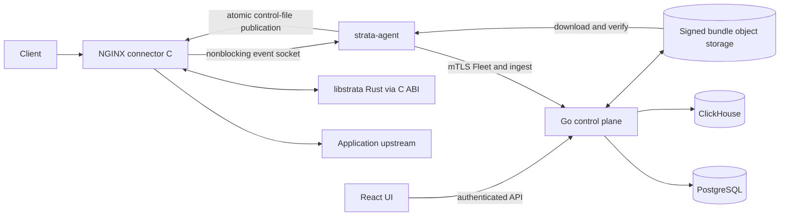
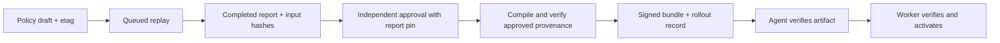

# Strata topology — reviewed main

Snapshot: consolidation #220, main `0a5100c`. This replaces the older branch's architecture sketch; it describes implementation boundaries, not a production deployment certificate. Feature status and limitations: [status](../status.md), [remediation tracker](../reports/remediation-tracker.md).

The connector owns NGINX request/body lifecycle and passes bounded byte slices across FFI. Detection and parsing live in Rust. Cooperative CPU budget and configured fail mode bound inspection; large requests can still be only partially inspected. Nonblocking event emission does not by itself guarantee delivery under saturation; agent spool/retry and ingest acknowledgements have separate boundaries.

Drafts, replay operations, approvals, annotations, audit entries and ingest watermarks use PostgreSQL. Events use ClickHouse. These databases do not share one commit: retries after ClickHouse commit but before the PostgreSQL watermark are possible. Event reads retain `FINAL`; crash-window acceptance tests exercise this case. Do not substitute naive insert-counting materialized views for logical event counts.

M4 automatic reduction of blocking is optional and disabled by default. An independently approved policy can delegate a restricted, add-only log-only derivation. Source/root guards, replay, signed runtime support and durable rollout recovery constrain that path; it does not authorize arbitrary policy edits or automatic re-enforcement.

Authentication can use local sessions or OIDC. UI visibility does not authorize a write; the API checks permissions. Fleet uses node credentials, distinct from administrator sessions. Private signing material and access tokens are not configuration examples to copy into this document.

The unmerged service-account, GeoIP/map, bot, standalone, rate/challenge and W21 branches require their own review. Their presence in another checkout is not evidence that main implements or deploys them. Gate A/B, real traffic, soak, multi-node drills and performance targets remain separate acceptance work.
