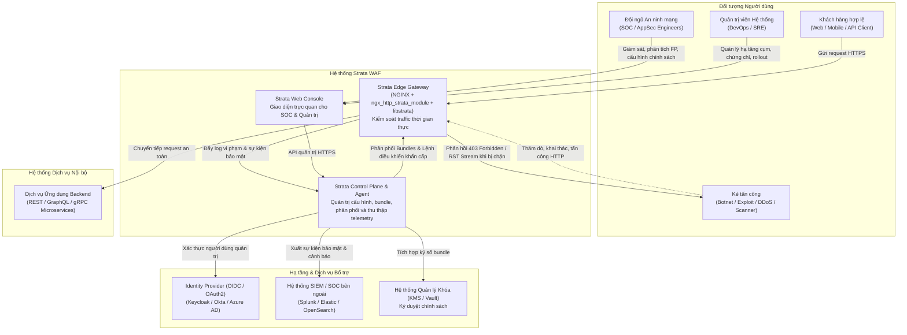
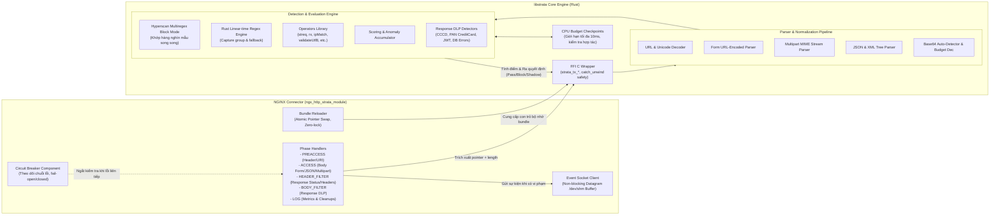
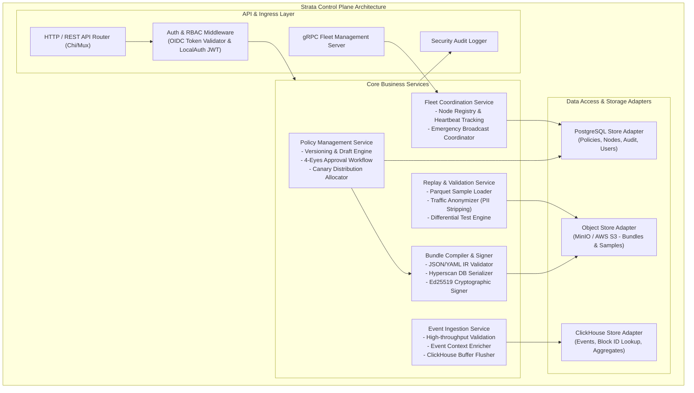
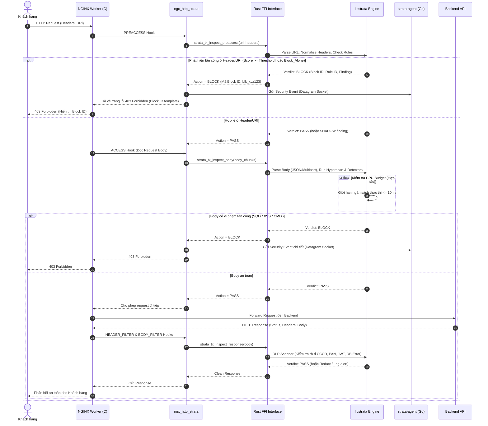
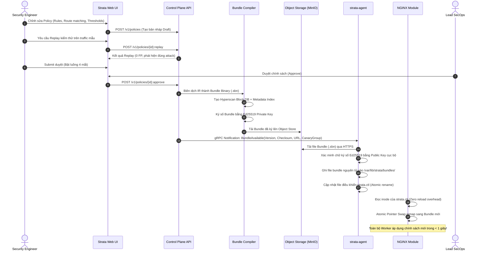

# Kiến trúc Hệ thống Strata WAF — Topology C4 & Service Modeling

Tài liệu thiết kế kiến trúc toàn diện cho hệ thống tường lửa ứng dụng web **Strata WAF**, áp dụng mô hình **C4 (Context, Container, Component, Deployment)**. Tài liệu mô tả trực quan cấu trúc hệ thống, ranh giới an ninh, phân tầng trách nhiệm và các luồng dữ liệu vận hành.

---

## 1. C4 Level 1: System Context Diagram (Bối cảnh Hệ thống)

Sơ đồ ngữ cảnh thể hiện vị trí của Strata WAF trong bức tranh tổng thể của doanh nghiệp: cách người dùng, kẻ tấn công, đội ngũ vận hành SOC và các hệ thống phụ trợ bên ngoài tương tác với WAF.



---

## 2. C4 Level 2: Container Diagram (Kiến trúc Container / Dịch vụ)

Strata được thiết kế theo kiến trúc phi tập trung, phân tách rạch ròi giữa **Data Plane (mặt phẳng dữ liệu thời gian thực)** và **Control Plane (mặt phẳng điều khiển và phân tích)** nhằm đảm bảo an toàn tuyệt đối, zero-downtime và không gây nghẽn đường truyền.

```mermaid
flowchart TB
    subgraph DataPlaneNode ["Edge Node (Data Plane)"]
        subgraph NginxProc ["NGINX Worker Process (C)"]
            NginxCore["NGINX Core\n(HTTP Processing Engine)"]
            StrataMod["ngx_http_strata_module.c\n(Connector Module C)"]
            ShmBreaker["Worker Circuit Breaker\n& Local Fallback State"]
        end

        subgraph EngineFFI ["libstrata.so (Rust Core)"]
            RustFFI["Strata C ABI FFI"]
            EngineCore["Detection & Eval Engine\n(Hyperscan, Tokenizer, Regex, DLP)"]
            CPUGuard["Cooperative CPU Budget Guard\n(Tối đa 10ms/request)"]
        end

        subgraph ShmStorage ["Shared Memory (/dev/shm)"]
            BundleShm["Active Bundle Image\n(mmap atomic pointer swap)"]
            MetricsShm["Atomic Counters\n(Requests, Blocks, Fallbacks)"]
            ControlFile["Control & Killswitch File\n(strata.ctl / disabled rules)"]
        end

        subgraph LocalAgent ["strata-agent (Go Daemon)"]
            AgentSock["Unix Datagram Listener\n(/run/strata/events.sock)"]
            Batcher["Spooler & Memory Batcher"]
            AgentFleet["Fleet Client (mTLS)\n& Bundle Manager"]
            PoissonCheck["Local Anomaly Detector\n(Poisson Error Spikes)"]
        end
    end

    subgraph ControlPlaneCluster ["Control Plane Cluster"]
        ControlPlaneAPI["strata-control-plane (Go)\n- Fleet Management Service (gRPC mTLS)\n- Policy Compiler & Signer (Ed25519)\n- Event Ingest Service\n- Replay & Anonymizer Engine\n- RBAC & LocalAuth / OIDC Handler"]
        
        WebUI["Strata Web Dashboard\n(React 18 + TypeScript + TailwindCSS + Vite)\nSPA phục vụ qua NGINX/CDN"]
    end

    subgraph StorageCluster ["Cơ sở Dữ liệu & Lưu trữ Phân tán"]
        Postgres["PostgreSQL 16+\n(Chính sách, Phiên bản, Node Enrollment, RBAC, Users)"]
        ClickHouse["ClickHouse Cluster\n(Sự kiện WAF, Block ID, Telemetry, Materialized Views)"]
        ObjectStore["MinIO / S3 Storage\n(Signature Packs, Signed Bundles, Parquet Replay Traffic)"]
    end

    %% Tương tác trong Data Plane Node
    NginxCore <-->|"HTTP Hooks (Preaccess, Body, Filter)"| StrataMod
    StrataMod <-->|"Zero-copy C ABI call"| RustFFI
    RustFFI --- EngineCore
    EngineCore --- CPUGuard
    StrataMod <-->|"Atomic read/swap"| BundleShm
    StrataMod <-->|"Atomic increment"| MetricsShm
    StrataMod <-->|"Đọc cờ khẩn cấp"| ControlFile
    StrataMod -->|"Non-blocking Datagram UDS"| AgentSock

    AgentSock --> Batcher
    Batcher --> AgentFleet
    PoissonCheck -.->|"Tự động kích hoạt Fallback khi lỗi vượt ngưỡng"| ControlFile
    AgentFleet -->|"Ghi bundle mới & cập nhật control"| BundleShm
    AgentFleet -->|"Gập nhật danh sách rule bị tắt"| ControlFile

    %% Tương tác Data Plane <-> Control Plane
    AgentFleet <==|"gRPC over mTLS (Port 8443)\n- Event Stream\n- Heartbeat & Presence\n- Bundle Pull / Push Notifications\n- Emergency Commands"|==> ControlPlaneAPI

    %% Tương tác Control Plane <-> UI & Storage
    WebUI <==|"REST HTTPS (Port 443 / 8080)\nJWT Bearer Token / Cookie"|==> ControlPlaneAPI
    ControlPlaneAPI <-->|"pgx Pool / SQL"| Postgres
    ControlPlaneAPI -->|"Batch Ingest TCP (9000/9440)"| ClickHouse
    ControlPlaneAPI <-->|"S3 API (HTTPS)"| ObjectStore
```

---

## 3. C4 Level 3: Component Diagram (Chi tiết Thành phần)

### 3.1. Thành phần NGINX Connector & Lõi Rust (`libstrata`)



### 3.2. Thành phần Strata Agent (`strata-agent`)

```mermaid
flowchart TD
    subgraph StrataAgentCore ["Strata Agent Architecture (Go)"]
        UDSListener["Unix Domain Socket Listener\n(/run/strata/events.sock, buffers: 8192)"]
        
        subgraph EventProcessing ["Event Ingest Pipeline"]
            Deduplicator["Event Deduplicator & Rate Limiter"]
            DiskSpooler["Disk Spooler (Fallback khi mất mạng)\n(/var/spool/strata-agent/queue.db)"]
            MemBatcher["In-Memory Chunk Batcher\n(Tối đa 1.000 events hoặc 500ms)"]
        end

        subgraph FleetManager ["Fleet & Lifecycle Manager"]
            EnrollmentClient["Auto-Enrollment Client\n(mTLS CSR, Token Exchange)"]
            HeartbeatPresence["Heartbeat & Health Reporter\n(Báo cáo CPU, Shm, Version, Drop rates)"]
            BundleSync["Bundle Synchronizer\n(Kiểm tra chữ ký Ed25519, ghi file atomic)"]
            CommandDispatcher["Emergency Command Dispatcher\n(DisableRules, ForceShadow, Rollback)"]
        end

        subgraph LocalWatchdog ["Local Watchdog & Anomaly Engine"]
            PoissonDetector["Poisson Anomaly Statistical Test\n(Theo dõi tỉ lệ spike 5xx/crash)"]
            ShmMetricsCollector["Shared Memory Metrics Reader\n(Đọc trực tiếp /dev/shm/strata_metrics)"]
            ControlWriter["Control File Writer\n(Ghi trạng thái fallback xuống strata.ctl)"]
        end
    end

    UDSListener --> Deduplicator
    Deduplicator --> MemBatcher
    MemBatcher -->|"Mất mạng"| DiskSpooler
    DiskSpooler -->|"Hồi phục"| MemBatcher
    
    ShmMetricsCollector --> PoissonDetector
    PoissonDetector -->|"Phát hiện bất thường nghiêm trọng"| ControlWriter
    CommandDispatcher --> ControlWriter

    FleetManager <==|"gRPC Stream mTLS"|==> RemoteCP["Strata Control Plane"]
    MemBatcher -->|"Đẩy Batch Events"| RemoteCP
```

### 3.3. Thành phần Strata Control Plane (`control-plane`)



---

## 4. C4 Level 4: Code & Data Flow / Deployment Diagram

### 4.1. Vòng đời Request và Quyết định WAF (Request Decision Pipeline)



### 4.2. Luồng Phát hành Chính sách & Ký số Bundle (Policy Distribution)



---

## 5. Ma trận Giao thức & Kết nối Mạng (Network & Protocol Matrix)

| Chiều giao tiếp | Nguồn | Đích | Giao thức | Cổng | Cơ chế Bảo mật & Xác thực | Mục đích |
| :--- | :--- | :--- | :--- | :--- | :--- | :--- |
| **Inbound Web** | Client / Internet | NGINX Proxy | HTTPS / HTTP2 / HTTP3 | 443, 80 | TLS 1.3, HSTS | Nhận lưu lượng người dùng |
| **IPC Nội bộ Node** | NGINX Module | strata-agent | Unix Domain Socket | `/run/strata/events.sock` | File system permissions (`0660`, group `strata`) | Đẩy sự kiện WAF non-blocking |
| **IPC Nội bộ Node** | strata-agent | NGINX Module | Shared Memory / FS | `/dev/shm`, `/var/lib/strata` | Kernel shm permissions, read-only mmap | Đọc metrics, nhận bundle, kiểm tra cờ tắt rule |
| **Management Mesh** | strata-agent | Control Plane | gRPC over HTTP/2 | 8443 | **Mutual TLS (mTLS)** với chứng chỉ Node CA riêng | Heartbeat, kéo bundle, stream sự kiện, nhận lệnh khẩn |
| **Admin Access** | Web UI / Browser | Control Plane | HTTPS | 443 / 8080 | TLS 1.3 + OIDC Bearer Token / Local JWT HttpOnly | Giao diện quản trị và điều hành SOC |
| **Event Pipeline** | Control Plane | ClickHouse | Native TCP / HTTP | 9000 / 8123 | TLS, User/Password, Dedicated DB `strata` | Lưu trữ sự kiện vi phạm và thống kê Block ID |
| **Relational Data** | Control Plane | PostgreSQL | PostgreSQL Wire | 5432 | TLS, Certificate/Password, Dedicated DB | Quản lý cấu hình, người dùng, audit log |
| **Artifact Store** | CP & Agent | MinIO / AWS S3 | HTTPS | 9000 / 443 | S3 IAM Signature v4 / TLS | Lưu trữ bundle nhị phân, parquet replay |

---

## 6. Mô hình Triển khai Hạ tầng (Deployment Topology)

```mermaid
flowchart TD
    subgraph InternetDMZ ["DMZ / Edge Network"]
        subgraph EdgeHost1 ["Edge Proxy Node 01"]
            NGINX1["NGINX Gateway + libstrata"]
            Agent1["strata-agent"]
        end
        subgraph EdgeHost2 ["Edge Proxy Node 02"]
            NGINX2["NGINX Gateway + libstrata"]
            Agent2["strata-agent"]
        end
        LB["Network Load Balancer (NLB)\n(Anycast / L4 DSR)"]
    end

    subgraph InternalMgmtVPC ["Management VPC (Phân vùng Cô lập)"]
        subgraph CPCluster ["Control Plane High-Availability"]
            CPInstance1["strata-control-plane #1"]
            CPInstance2["strata-control-plane #2"]
            InternalLB["Internal ALB (mTLS termination / passthrough)"]
        end

        subgraph DBCluster ["Cụm Dữ liệu Đa tầng"]
            PGPrimary["PostgreSQL Primary"]
            PGStandby["PostgreSQL Standby"]
            CHCluster["ClickHouse 2-Shard Cluster (Zookeeper/Keeper)"]
            MinIOCluster["MinIO Distributed 4-Node"]
        end
    end

    LB --> NGINX1
    LB --> NGINX2
    Agent1 ==|"mTLS Outbound"|==> InternalLB
    Agent2 ==|"mTLS Outbound"|==> InternalLB
    InternalLB --> CPInstance1
    InternalLB --> CPInstance2

    CPInstance1 --> PGPrimary
    CPInstance2 --> PGPrimary
    PGPrimary -.->|"Streaming Replication"| PGStandby
    CPInstance1 --> CHCluster
    CPInstance2 --> CHCluster
    CPInstance1 --> MinIOCluster
    CPInstance2 --> MinIOCluster
```

Tài liệu này xác lập cấu trúc chuẩn mực về Topology C4 cho hệ thống Strata WAF, làm cơ sở cho công tác kiểm toán mã nguồn, vận hành và mở rộng quy mô.
