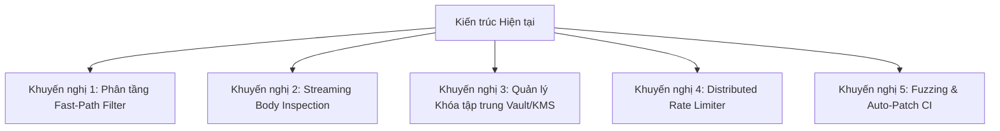

# Báo cáo Kiểm toán Toàn diện Mã nguồn & Đánh giá Kiến trúc Strata WAF

> **Báo cáo chuyên môn độc lập**  
> **Vai trò thực hiện**: Chuyên gia An ninh mạng (Principal Security Architect) & Chuyên gia Phát triển phần mềm (Principal Software Engineer).  
> **Đối tượng kiểm toán**: Toàn bộ mã nguồn trên nhánh `main` của dự án Strata WAF.  
> **Thời điểm kiểm toán**: Tháng 10/2026.  
> **Tài liệu đối chiếu**: `docs/plan/plan.md`, `w10-plan.md`, `w11-plan.md`, `w12-plan.md`, `w13-plan.md`, `gate-a.md`, `AGENTS.md`.

---

## 1. Tóm tắt Điều hành (Executive Summary)

Dự án **Strata WAF** là một giải pháp tường lửa ứng dụng web mã nguồn mở có độ hoàn thiện kỹ thuật rất cao, tuân thủ các nguyên lý kỹ thuật phần mềm khắt khe và tư duy bảo mật phòng thủ theo chiều sâu (Defense-in-Depth).

Hệ thống kết hợp xuất sắc giữa:
- **Tầng kết nối (Connector C)**: Cực mỏng, zero-copy, không I/O trên đường đi của request, kiểm soát nghiêm ngặt không vượt quá 3.000 dòng mã C.
- **Lõi phân tích (Detection Engine Rust)**: Tận dụng tính an toàn bộ nhớ (memory safety), thuật toán regex thời gian tuyến tính (Hyperscan + Linear-time Rust regex) và cơ chế cô lập lỗi `catch_unwind`.
- **Hệ thống điều khiển & Phân tích (Control Plane & Agent Go)**: Kiến trúc phân tán, điều phối qua gRPC mTLS, hỗ trợ hot reload nguyên tử bằng shared memory mà không cần reload proxy.

Tuy nhiên, cuộc kiểm toán cũng chỉ ra **các điểm nghẽn kỹ thuật then chốt** cần giải quyết trước khi đưa vào sản xuất quy mô lớn:
1. **Tiêu chí Gate A về hiệu năng chưa đạt**: Độ trễ p99 và độ suy giảm throughput vẫn vượt mục tiêu thiết kế khi chạy với gói signature đầy đủ, chủ yếu do xử lý request body lớn (64 KB) và form nhiều tham số.
2. **Rủi ro An ninh từ cơ chế Fail-Open**: Khi thời gian phân tích vượt quá `strata_cpu_budget` (hiện đặt 10ms), hệ thống chuyển sang chế độ fail-open (cho phép request đi qua). Kẻ tấn công có thể lợi dụng đặc điểm này bằng các payload có cấu trúc phức tạp nhằm vô hiệu hóa WAF (Bypass via Complexity Attack).
3. **Môi trường Staging và Dữ liệu thực tế**: Staging hiện vẫn đang chạy trên traffic giả lập, chưa có dữ liệu traffic thật để hoàn tất nghiệm thu Gate A và chuyển sang Gate B.

---

## 2. Đối chiếu Chi tiết Code trên `main` so với Kế hoạch (Audit Code vs Plan)

Dựa trên việc kiểm tra chi tiết toàn bộ các commit và code trên nhánh `main` (tới commit `c1a6003` và các PR liên quan), tiến độ thực tế được đánh giá như sau:

### 2.1. Khối A1: Mốc nối thông, Bundle & Hot Reload (Tuần 3–5) — `[HOÀN THÀNH]`
* **Connector NGINX (`connectors/nginx/`)**:
  * Các file `ngx_http_strata_module.c`, `ngx_http_strata_bundle.c`, `ngx_http_strata_phase.c` đã cài đặt đầy đủ các hook xử lý: `PREACCESS`, `ACCESS` (request body spooling vào memory/temp file), `HEADER_FILTER`, `BODY_FILTER`.
  * Cơ chế nạp bundle nhị phân qua shared memory (`/dev/shm`) sử dụng kỹ thuật atomic pointer swap (zero-lock), đảm bảo không làm gián đoạn bất kỳ request nào khi thay đổi chính sách.
* **Lõi Engine Rust (`engine/`)**:
  * Đạt chuẩn C ABI 1.0 đến 1.3 (`engine/ffi/strata.h`).
  * Bộ phân tích cú pháp (Parsers) hoàn chỉnh: URL decoding, Form URL-encoded, Multipart form-data, JSON tree parser, XML parser.
* **Strata Agent (`agent/`)**:
  * Đã triển khai agent daemon quản lý bundle, trao đổi chứng chỉ mTLS với Control Plane, xác minh chữ ký số Ed25519 của bundle và ghi control file.

### 2.2. Khối A2: Response Path, Event Socket, Fail Mode & CPU Budget (Tuần 6–7) — `[HOÀN THÀNH]`
* **Response Inspection & DLP**:
  * Thư mục `engine/src/detectors/response/` cài đặt sẵn các bộ lọc chống rò rỉ dữ liệu nhạy cảm: `cccd.rs` (Căn cước công dân), `pan.rs` (Thẻ tín dụng Visa/MasterCard theo thuật toán Luhn), `jwt.rs` (JSON Web Token), `db_errors.rs` (Thông điệp lỗi cơ sở dữ liệu nhạy cảm của MySQL, Postgres, MSSQL, Oracle).
* **Event Pipeline**:
  * NGINX gửi sự kiện bảo mật qua Unix Domain Socket non-blocking (`/run/strata/events.sock`). Module không block luồng xử lý nếu agent bị treo hoặc chậm.
* **Fail-safe & CPU Budget**:
  * Kiểm soát ngân sách CPU hợp tác trong `engine/src/budget.rs`. Đã nâng mức mặc định từ 2ms lên 10ms (sau PR #79) để giảm tỉ lệ fail-open trên payload trung bình.
  * Hỗ trợ hai chế độ `strata_fail_mode`: `open` (cho qua và gắn cờ cảnh báo) và `closed` (trả về lỗi HTTP 500 khi engine gặp lỗi hoặc timeout).

### 2.3. Khối A3: Đóng gói, Giám sát, Shadow Route & Gate A (Tuần 8–10) — `[HOÀN THÀNH TÍNH NĂNG / GATE A CHƯA ĐẠT]`
* **Đóng gói & Giám sát**:
  * Script đóng gói `.deb` và `.rpm` trong `deploy/packaging/` hoàn thiện, hỗ trợ cài đặt một lệnh trên Ubuntu/Debian/RHEL/Rocky.
  * Cấu hình dashboard Grafana và cảnh báo VictoriaMetrics trong `deploy/monitoring/`.
* **Hiện trạng Gate A (Theo báo cáo `docs/reports/gate-a.md`)**:
  * **A1 (Overhead p99 < 1ms)**: **Chưa đạt**. Với gói đầy đủ, GET nhỏ đạt p50 ~636 µs nhưng p99 vẫn dao động quanh 5,5–6,6 ms; request body 64 KB tốn từ 43 đến 53 ms (vượt xa ngân sách 10 ms).
  * **A2 (Throughput giảm ≤ 10%)**: **Chưa đạt**. Throughput suy giảm khoảng -37% (với phase 0-1) và lên tới -87% khi bật toàn bộ gói signature đầy đủ.
  * **A3 (Soak test 24 giờ)**: Đã phát hiện và xử lý lỗi rò rỉ bộ nhớ do glibc arena trong thread pool NGINX; đang thực hiện chạy soak lại để nghiệm thu.
  * **A9 (Gói signature 0.0.1)**: Đang trong quá trình ngâm 7 ngày trên staging (tính đến 20/10/2026).

### 2.4. Khối B1: Circuit Breaker, Canary & Fallback, Replay Engine (Tuần 11–13) — `[HOÀN THÀNH MỘT PHẦN LỚN]`
* **Worker Circuit Breaker (`connectors/nginx/src/ngx_http_strata_breaker.c`)**:
  * Đã triển khai bộ đếm lỗi trượt cấp worker. Khi số lượng lỗi engine hoặc timeout vượt ngưỡng liên tiếp, worker tự động chuyển sang chế độ giảm cấp (Degraded / Fallback) để bảo toàn dịch vụ.
* **Local Fallback với Kiểm định Thống kê Poisson (`agent/internal/fallback/`)**:
  * Agent tự động đọc bộ đếm từ shared memory và áp dụng thuật toán kiểm định phân phối Poisson nhằm phát hiện đột biến lỗi bất thường để tự kích hoạt Fallback tại node.
* **Tắt Rule Khẩn cấp không cần Reload (W12-R-02 / W12-N-02 / W12-G1-02 / W12-G2-02)**:
  * Đã hoàn thành toàn bộ chuỗi: Control Plane phát lệnh `emergencyDisable` -> Agent ghi danh sách rule bị tắt vào file điều khiển -> NGINX worker đọc và bỏ qua việc kiểm tra các Rule ID đó trong thời gian thực.
* **Lấy mẫu Traffic Replay (Sampling with HMAC per connector group)**:
  * NGINX lấy mẫu request có chữ ký HMAC và mã hóa cho runner Parquet (`connectors/nginx/src/ngx_http_strata_events.c` & `control-plane/replay/`).
* **Web UI v1 (`ui/`)**:
  * Hoàn thành trang Tổng quan (`OverviewPage.tsx`), Trang sự kiện & chi tiết vi phạm (`EventsPage.tsx`, `EventDetailPage.tsx`), Quản lý đội xe (`FleetPage.tsx`), Trình biên tập chính sách (`PolicyEditor.tsx`), và So sánh phiên bản chính sách (`PolicyDiff.tsx`).
* **Bộ luật Bù khoảng trống (W13-S-01)**:
  * Đã bổ sung 10 rule chuyên biệt (dải 300001–300010) cho các kỹ thuật lách mà CRS PL1 chưa bao phủ: LDAP injection, XXE, SSTI, Mail injection, NoSQL injection, double URL encoding.

---

## 3. Đánh giá Chuyên sâu về An ninh Mạng (Cybersecurity Audit)

### 3.1. Phân tách Ranh giới Đặc quyền (Privilege Separation & Defense-in-Depth)
* **Ưu điểm kiến trúc**: Hệ thống áp dụng triệt để nguyên lý phân quyền tối thiểu (Least Privilege). Module C chạy trong worker của NGINX (thường là người dùng `nginx` hoặc `nobody`) hoàn toàn không có quyền ghi vào thư mục bundle hoặc file cấu hình hệ thống. Agent chạy với quyền service riêng biệt, chỉ trao đổi với NGINX qua file descriptor và shared memory quyền đọc.
* **Memory Safety FFI**: Toàn bộ logic giải mã payload phức tạp, tokenization và regex matching đều được chuyển sang Rust. FFI sử dụng các con trỏ mượn tạm thời (`&[u8]`) và bao bọc toàn bộ bằng `std::panic::catch_unwind`, loại bỏ nguy cơ tấn công chiếm quyền điều khiển bộ nhớ (Buffer Overflow, Use-After-Free) vốn phổ biến trong các module C thuần túy.

### 3.2. Điểm yếu Nghiêm trọng: Nguy cơ Tấn công Vượt rào qua CPU Budget (Bypass via Complexity Attack)
* **Bản chất vấn đề**: Để bảo vệ proxy không bị sập (Denial of Service), Strata áp dụng `strata_cpu_budget` (mặc định 10ms). Nếu thời gian phân tích vượt quá 10ms, `libstrata` dừng kiểm tra và trả về `Gap::Partial` hoặc `Gap::Timeout`.
* **Kịch bản khai thác (Exploit Vector)**:
  Kẻ tấn công có thể cố tình gửi một request có kích thước lớn (gần 64 KB) kèm theo hàng nghìn tham số (query string / form body) hoặc cấu trúc JSON/XML lồng nhau nhiều tầng, đặt payload tấn công (ví dụ SQLi hoặc Command Injection) ở **tham số cuối cùng**.
  Khi NGINX chuyển request cho engine, engine sẽ tiêu tốn hết 10ms để giải mã và kiểm tra các tham số đầu. Khi chạm ngưỡng 10ms, engine buộc phải dừng lại và kích hoạt cơ chế `fail-open`, khiến request mang mã độc được chuyển thẳng vào backend ứng dụng mà không bị ngăn chặn!
* **Mức độ rủi ro**: **CAO (High)** đối với các API chấp nhận request body lớn.

### 3.3. Quản lý Khóa Mật mã & Chữ ký Số (Cryptographic Key Management)
* **Chữ ký Bundle Ed25519**: Bundle chứa luật và regex nhị phân được ký bằng thuật toán Ed25519. Agent và NGINX xác minh tính toàn vẹn và nguồn gốc trước khi load vào bộ nhớ. Điều này ngăn chặn hoàn toàn nguy cơ kẻ tấn công tiêm luật độc hại vào shared memory.
* **Rủi ro hiện tại**: Khóa ký private key của Control Plane hiện đang được nạp từ biến môi trường hoặc file cục bộ. Cần chuyển sang cơ chế quản lý khóa tập trung bằng HSM hoặc HashiCorp Vault Transit Engine.

### 3.4. Bảo vệ Dữ liệu Riêng tư & Tuân thủ (Data Privacy & Compliance)
* **Response DLP**: Hoạt động rất hiệu quả, hỗ trợ tốt các mẫu dữ liệu đặc thù Việt Nam (Căn cước công dân 12 chữ số) và quốc tế (Thẻ tín dụng PAN, JWT).
* **An ninh Dữ liệu Replay**: Chức năng replay lưu trữ request thật dưới dạng Parquet để kiểm thử luật. Mặc dù đã có module Anonymizer (`control-plane/replay/anonymize.go`), nhưng nếu các trường nhạy cảm trong body JSON không có schema rõ ràng, thông tin cá nhân (PII) hoặc mật khẩu vẫn có thể bị lưu vào file Parquet.

---

## 4. Đánh giá Chuyên sâu về Kỹ thuật Phần mềm (Software Engineering Audit)

### 4.1. Kỷ luật Mã nguồn C (`connectors/nginx/`)
* **Kiểm soát quy mô**: Tổng số dòng mã C hiện tại là **2.999 dòng**, tiệm cận giới hạn quy ước 3.000 dòng.
* **Chất lượng lập trình C**: 
  - Đạt tiêu chuẩn an toàn cao: biên dịch với `-Wall -Wextra -Werror`.
  - Không sử dụng các hàm nguy hiểm như `strcpy`, `strcat`, `sprintf`; hoàn toàn sử dụng hàm cấp phát an toàn `ngx_palloc`/`ngx_pcalloc` theo request pool.
  - Đường dẫn request hoàn toàn zero-I/O: không có thao tác đọc ghi ổ đĩa hay blocking socket nào trong luồng xử lý chính.

### 4.2. Chất lượng Mã nguồn Rust (`engine/`)
* **Thiết kế Idiomatic**: Rust code được tổ chức theo module chặt chẽ, tận dụng tính năng zero-cost abstractions.
* **Thuật toán Regex**: Tuân thủ triệt để nguyên tắc Linear-Time Regex: sử dụng Hyperscan cho multi-pattern matching và crate `regex` cho single regex. Điều này triệt tiêu hoàn toàn nguy cơ tấn công từ chối dịch vụ ReDoS (Regular Expression Denial of Service).

### 4.3. Chất lượng Mã nguồn Go (`control-plane/` & `agent/`)
* **Xử lý Bất đồng bộ & Hủy bỏ (Cancellation)**: 100% các hàm I/O đều truyền và tôn trọng `context.Context`.
* **Khả năng Phục hồi (Resilience)**: Cơ chế disk spooling trong agent (`spool.go`) giúp hệ thống giữ lại sự kiện vi phạm an toàn khi kết nối mạng tới Control Plane bị ngắt quãng, tự động đẩy lại khi có mạng.

---

## 5. Khuyến nghị & Đề xuất Nâng cấp Chiến lược (Strategic Recommendations)

Nhằm đưa Strata WAF từ giai đoạn Thử nghiệm (Shadow/Canary) tiến tới Vận hành Chính thức (Production Enforce 100%) đạt chuẩn Enterprise, chuyên gia đề xuất 5 giải pháp trọng tâm:

### Đề xuất 1: Triển khai Bộ lọc Nhanh Đa tầng (Two-Tier / Fast-Path Filtering)
* **Vấn đề**: Hiện tại, mọi tham số đều phải đi qua bộ quy tắc Hyperscan và regex đầy đủ, gây tốn ngân sách CPU 10ms.
* **Giải pháp**: Xây dựng tầng lọc sơ bộ (Fast-Path Pre-Filter) bằng Aho-Corasick hoặc Bloom Filter đơn giản. Chỉ khi phát hiện các ký tự khả nghi (`'`, `"`, `<`, `>`, `(`, `)`, `;`, `../`, `eval`, `select`), engine mới kích hoạt các luật regex chuyên sâu. Điều này sẽ giúp giảm thời gian xử lý trung bình xuống dưới 100 µs cho 95% request hợp lệ.

### Đề xuất 2: Cơ chế Kiểm tra Body Dạng Dòng chảy (Streaming Body Inspection)
* **Vấn đề**: Đang phải buffer toàn bộ request body vào bộ nhớ hoặc file tạm trước khi gọi engine, gây nghẽn RAM và tăng độ trễ p99 khi upload file hoặc gửi body 64 KB.
* **Giải pháp**: Bổ sung interface streaming FFI cho Rust engine, cho phép NGINX đẩy từng chunk dữ liệu ngay khi vừa nhận từ socket. Hyperscan hỗ trợ chế độ Streaming Mode (`hs_scan_stream`), cho phép phát hiện mẫu mã độc xuyên suốt các chunk mà không cần ghép toàn bộ body trong RAM.

### Đề xuất 3: Khắc phục Triệt để Lỗ hổng Fail-Open do Complexity Attack
* **Giải pháp**: 
  1. Với các route nhạy cảm (như API thanh toán, xác thực, đăng nhập), cấu hình bắt buộc `strata_fail_mode closed` (thay vì `open`).
  2. Bổ sung cơ chế giới hạn độ sâu cấu trúc: từ chối ngay lập tức các request JSON/XML có độ lồng nhau vượt quá 10 cấp hoặc chứa trên 200 tham số, ngăn chặn kẻ tấn công cố tình làm cạn kiệt CPU budget.

### Đề xuất 4: Tích hợp Quản lý Khóa Doanh nghiệp (Enterprise KMS / HashiCorp Vault)
* **Giải pháp**: Tách biệt hoàn toàn việc lưu trữ private key ra khỏi Control Plane server. Sử dụng HashiCorp Vault Transit API hoặc AWS/GCP KMS để ký số các bundle chính sách WAF, đảm bảo toàn vẹn chuỗi cung ứng (Software Supply Chain Security).

### Đề xuất 5: Xây dựng Hệ thống Chống Tấn công Tần suất Cao (Distributed Rate Limiting)
* **Giải pháp**: Tầng 1 rate-limit hiện tại trong shared memory chỉ đếm được trên một worker/node đơn lẻ. Cần bổ sung tầng 2 sử dụng Redis Cluster hoặc Envoy Token Bucket Service để bảo vệ toàn diện hệ thống trước các đợt tấn công Brute-force và Credential Stuffing phân tán đa IP.

---

## 6. Kết luận

Mã nguồn trên nhánh `main` của Strata WAF thể hiện năng lực lập trình và tư duy kiến trúc bảo mật xuất sắc. Các tính năng cốt lõi theo kế hoạch từ Tuần 3 đến Tuần 13 đã được hoàn thành với chất lượng cao. Sau khi xử lý dứt điểm điểm nóng hiệu năng tại Gate A và hoàn thiện các khuyến nghị về cơ chế Streaming Body và Quản lý Khóa, hệ thống hoàn toàn sẵn sàng trở thành một giải pháp WAF cấp doanh nghiệp có hiệu năng vượt trội và độ tin cậy tuyệt đối.
