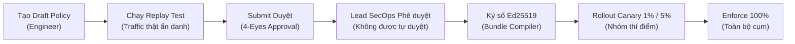
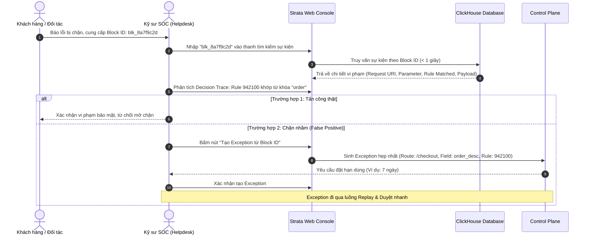

# Hướng dẫn Sử dụng & Vận hành Hệ thống Strata WAF

Tài liệu hướng dẫn chi tiết dành cho **Kỹ sư An ninh mạng (SecOps)**, **Kỹ sư Vận hành (SRE/DevOps)** và **Đội ngũ Điều hành An ninh (SOC)** nhằm cài đặt, cấu hình, quản trị chính sách và xử lý sự cố với Strata WAF.

---

## 1. Hướng dẫn Cài đặt & Triển khai Ban đầu

### 1.1. Cài đặt trên Edge Gateway (NGINX Node)

Strata cung cấp gói cài đặt nhị phân cho các bản phân phối Linux phổ biến (Ubuntu 22.04/24.04, Debian 12, RHEL/Rocky 9).

#### Cài đặt qua Package Repository (.deb / .rpm)
```bash
# Trên Ubuntu / Debian:
sudo apt-get update
sudo apt-get install -y ngx-http-strata-module strata-agent

# Trên RHEL / Rocky Linux:
sudo dnf install -y ngx-http-strata-module strata-agent
```

Gói cài đặt sẽ tự động:
- Đặt module động tại `/usr/lib/nginx/modules/ngx_http_strata_module.so`.
- Đặt thư viện lõi Rust tại `/usr/lib/strata/libstrata.so`.
- Tạo user/group hệ thống `strata`.
- Cấu hình systemd service cho `strata-agent.service` và socket activation `strata-agent.socket`.

#### Cấu hình NGINX khởi động Module
Thêm dòng sau vào đầu file `/etc/nginx/nginx.conf`:
```nginx
load_module modules/ngx_http_strata_module.so;
```

---

### 1.2. Cấu hình Tham số Directives của Strata trên NGINX

Tại khối `http` hoặc `server`, thiết lập các chỉ thị cốt lõi:

```nginx
http {
    # 1. Bật WAF Engine
    strata_engine on;

    # 2. Đường dẫn quản lý Bundle và file điều khiển trạng thái
    strata_bundle_dir    /var/lib/strata/bundles;
    strata_control_file  /var/lib/strata/strata.ctl;

    # 3. Socket đẩy sự kiện bảo mật sang strata-agent (non-blocking)
    strata_event_socket  unix:/run/strata/events.sock;

    # 4. Ngân sách CPU tối đa cho mỗi request (mặc định 10ms)
    strata_cpu_budget    10ms;

    # 5. Chế độ khi gặp lỗi hoặc quá thời gian (open: cho qua | closed: chặn lỗi 500)
    strata_fail_mode     open;

    # 6. Ngưỡng Circuit Breaker cấp worker
    strata_breaker_errors 10;
    strata_breaker_window 60s;

    # 7. Trang phản hồi khi bị chặn kèm Block ID
    strata_block_page    /usr/share/nginx/html/strata_block.html;

    server {
        listen 443 ssl http2;
        server_name api.example.com;

        location / {
            # Gán policy tương ứng với route
            strata_policy pilot_api_v1;

            proxy_pass http://backend_upstream;
        }

        # Trang API nhạy cảm yêu cầu fail-closed nghiêm ngặt
        location /api/v1/auth/login {
            strata_policy auth_strict;
            strata_fail_mode closed; # Không cho qua nếu WAF timeout/lỗi

            proxy_pass http://backend_upstream;
        }
    }
}
```

---

### 1.3. Cấu hình Strata Agent (`/etc/strata/agent.yaml`)

```yaml
node_id: "edge-node-hcm-01"
connector_group: "edge-prod-south"

# Địa chỉ lắng nghe sự kiện từ NGINX
socket_path: "/run/strata/events.sock"
socket_buffer_size: 8192

# Kết nối Control Plane mTLS
control_plane:
  endpoint: "cp.strata.internal:8443"
  ca_cert: "/etc/strata/certs/cp_ca.crt"
  client_cert: "/etc/strata/certs/agent.crt"
  client_key: "/etc/strata/certs/agent.key"

# Bộ đệm sự kiện khi mất mạng
spool:
  enabled: true
  dir: "/var/spool/strata-agent"
  max_size_mb: 500

# Quản lý bundle cục bộ
bundles:
  dir: "/var/lib/strata/bundles"
  control_file: "/var/lib/strata/strata.ctl"
  public_key: "/etc/strata/keys/bundle_signing.pub"
```

Khởi chạy Agent:
```bash
sudo systemctl enable --now strata-agent.socket
sudo systemctl enable --now strata-agent.service
```

---

## 2. Quản trị Chính sách Bảo mật (WAF Policy Lifecycle)

### 2.1. Cấu trúc File Policy YAML

Chính sách bảo mật được viết dưới dạng YAML tường minh:

```yaml
id: "policy-prod-core"
version: "v1.2.0"
mode: "enforce" # enforce | shadow

routes:
  - id: "route-public-api"
    prefix: "/api/v1/"
    action_mode: "score"
    anomaly_threshold: 5
    rules:
      - rule_id: 100001 # Rule SQLi
        action: "block"
      - rule_id: 941100 # XSS PL1
        action: "score"
        score: 5

  - id: "route-checkout"
    prefix: "/checkout"
    action_mode: "block_alone"
    rules_overrides:
      - rule_id: 942100 # Tắt tạm thời rule cụ thể
        enabled: false

response_inspection:
  enabled: true
  detectors:
    - name: "vietnamese_cccd"
      action: "log_alert"
    - name: "credit_card_pan"
      action: "mask" # Che số thẻ: ************1234
```

### 2.2. Quy trình Duyệt 4 Mắt & Phân phối Canary (4-Eyes & Canary Deployment)

Nhằm đảm bảo an toàn tuyệt đối cho hệ thống tài chính/thương mại điện tử:



1. **Kiểm tra Replay**: Trước khi áp dụng, bấm nút **Run Replay** trên UI để chạy thử policy trên 100.000 request thực tế gần nhất, đảm bảo 0 ca chặn nhầm (False Positive).
2. **Duyệt 4 mắt**: Người tạo bản nháp không thể tự phê duyệt bản nháp của mình. Cần một tài khoản có vai trò `Policy Approver` xác nhận.
3. **Phân luồng Canary**: Thiết lập tỉ lệ canary (ví dụ 5%). Control Plane sẽ tự động tính toán hash và gán cờ `canary` trong bundle cho các node thuộc nhóm thử nghiệm.

---

## 3. Cẩm nang Điều hành & Giám sát SOC (SOC Operations)

### 3.1. Quy trình Xử lý Khiếu nại Chặn nhầm (False Positive Investigation)

Khi khách hàng hoặc hệ thống đối tác báo bị lỗi 403 Forbidden:



### 3.2. Tắt Khẩn cấp Rule ID (Emergency Disable Rule)

Trong tình huống khẩn cấp, khi một Rule bị tấn công False Positive ồ ạt gây ảnh hưởng nghiêm trọng tới doanh thu:

1. Truy cập **Strata Web Console** -> Mục **Rules Catalog**.
2. Tìm kiếm Rule ID đang gặp sự cố (ví dụ: `942100`).
3. Bấm **Emergency Disable** -> Chọn nhóm cụm (ví dụ: `All Production Nodes`).
4. Điền lý do sự cố (bắt buộc cho Audit Log) và bấm **Confirm**.
5. **Hiệu lực tức thì**: Lệnh được đẩy qua gRPC tới toàn bộ Agent; NGINX worker cập nhật cờ tắt rule trong **dưới 1 giây** mà **không cần reload NGINX**.

---

## 4. Runbook Xử lý Sự cố Vận hành Khẩn cấp (SRE Incident Runbook)

### 4.1. Kích hoạt Chế độ Ép Shadow Toàn Cụm (Force Shadow)
Áp dụng khi hệ thống nghi ngờ có lỗi logic WAF trên diện rộng cần ngưng chặn khẩn cấp mà vẫn tiếp tục ghi nhận sự kiện phục vụ điều tra:

```bash
# Thực hiện bằng CLI trên Control Plane:
strata-admin fleet force-shadow --group all --reason "Incident INC-2026-10-15-01" --duration 1h

# Hoặc thực hiện cục bộ tại Node (khi mất kết nối Control Plane):
echo "force_shadow 1" | sudo tee /var/lib/strata/strata.ctl
```

Toàn bộ các quyết định `BLOCK` sẽ tự động chuyển thành `SHADOW` (ghi nhận log nhưng cho phép request đi tiếp).

### 4.2. Khôi phục Phiên bản Bundle Cũ (Rollback Bundle)
Khi bundle mới vừa phát hành gây lỗi nghiêm trọng:

```bash
# Rollback trên Control Plane:
strata-admin policy rollback --policy-id policy-prod-core --to-version v1.1.9

# Rollback khẩn cấp tại Node NGINX:
cd /var/lib/strata/bundles
sudo ln -sf bundle_v1.1.9.sbn active.sbn
sudo systemctl reload nginx # Chỉ cần thiết nếu atomic swap bị khóa
```

### 4.3. Xử lý khi Agent hoặc Control Plane Gặp Sự cố
* **Đặc tính độc lập của NGINX Data Plane**: Module NGINX và lõi `libstrata` được thiết kế hoàn toàn tự chủ. Khi Control Plane hoặc `strata-agent` bị sập:
  - NGINX **vẫn tiếp tục bảo vệ hệ thống** dựa trên Bundle đã được nạp trong shared memory.
  - Bộ đệm datagram socket sẽ tự drop log khi queue đầy, tuyệt đối **không làm nghẽn hoặc dừng lưu lượng web** của khách hàng.
  - Khởi động lại Agent bằng lệnh:
    ```bash
    sudo systemctl restart strata-agent.service
    ```

---

## 5. Danh mục Cổng & Biến Môi trường Quản trị

| Dịch vụ | Biến môi trường quan trọng | Giá trị mặc định | Ý nghĩa |
| :--- | :--- | :--- | :--- |
| `strata-agent` | `STRATA_AGENT_NODE_ID` | Hostname | Định danh node trên Fleet |
| `strata-agent` | `STRATA_CP_ENDPOINT` | `localhost:8443` | Địa chỉ Control Plane |
| `strata-agent` | `STRATA_SOCKET_PATH` | `/run/strata/events.sock` | Socket nhận event từ NGINX |
| `control-plane` | `STRATA_DB_URL` | `postgres://...` | Chuỗi kết nối PostgreSQL |
| `control-plane` | `STRATA_CLICKHOUSE_URL` | `tcp://...` | Chuỗi kết nối ClickHouse |
| `control-plane` | `STRATA_SIGNING_KEY_PATH` | `/etc/strata/keys/ed25519.key` | Khóa ký số Bundle |
| `control-plane` | `STRATA_OIDC_ISSUER` | `https://sso.example.com` | Địa chỉ IdP OIDC |
