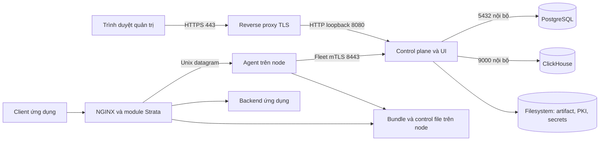

# 01 · Chuẩn bị và cài control plane

[Trang đầu](README.md) · Tiếp: [cấu hình](02-configuration.md)

## 1. Chọn kiến trúc

Compact mặc định có ba container trên một máy. NGINX/agent chạy trên các node proxy,
có thể cùng máy trong lab nhưng vẫn là các tiến trình và phạm vi dữ liệu riêng.



Control plane không nằm trên đường đi HTTP của ứng dụng. Khi control plane ngừng,
node tiếp tục dùng bundle hợp lệ hiện có; agent giữ sự kiện trong spool có giới hạn.
Điều này không bảo đảm không mất sự kiện nếu gián đoạn vượt dung lượng spool.

Một control plane giữ lease PostgreSQL. Không scale `control-plane` lên nhiều replica
và không tắt lease để mô phỏng HA. Thiết kế này dùng backup/restore để phục hồi.

## 2. Chuẩn bị máy và dữ liệu

Cần Linux, Docker Engine và Compose v2, Git, Bash, kết nối tới registry và kho package
cho bước build. Quyền truy cập Docker tương đương quyền quản trị host: chỉ cấp cho
người vận hành tin cậy. Bộ gói node hiện nhắm x86_64; không suy ra hỗ trợ ARM.

Kiểm tra trước khi bắt đầu:

```bash
docker version
docker compose version
git --version
uname -m
df -h
df -i
free -h
```

Giới hạn RAM container mặc định là PostgreSQL 1 GiB, ClickHouse 3 GiB, control plane
2 GiB: tổng 6 GiB, chưa tính OS, page cache, Docker và build. Không coi đây là mức RAM
nhàn rỗi đo được hoặc sizing cam kết. Cho triển khai thử, có thể dự trù máy 8 GiB RAM
hoặc lớn hơn, sau đó đo theo lưu lượng thực; build cần thêm tài nguyên và dung lượng.
Không có ngưỡng RPS/node được chứng nhận trong tài liệu này.

Tách vùng dữ liệu khi có thể:

| Vùng | Nội dung | Hậu quả khi hết chỗ/mất |
| --- | --- | --- |
| Volume `postgres` | User, policy, inventory, audit, release metadata | Mất quyền quản trị và trạng thái điều khiển |
| Volume `clickhouse` | Sự kiện, thống kê, materialized views | Mất quan sát/lịch sử; spool node tăng |
| Volume `strata-data` | PKI, khóa ký, secrets, YAML, artifact | Không ký/phân phối được; có thể mất trust |
| `deploy/compact/backups` | Archive mã hóa | Cùng host không chống mất cả máy |
| `deploy/compact/.state/env` | Mật khẩu dịch vụ, UID/GID | Cần giữ riêng để duy trì kết nối đúng volume |

Tên volume Docker thực tế có tiền tố project; dùng `docker volume inspect` để xác
nhận mountpoint. Không tự xóa volume để giải quyết lỗi khởi động. Theo dõi dung lượng
lẫn inode. Đĩa ClickHouse đầy không nên làm PostgreSQL hoặc artifact đầy theo.

Ước lượng sự kiện bằng `số sự kiện/ngày × byte thực lưu/sự kiện × số ngày`, cộng index,
merge tạm, log và dư địa vận hành. Đo trên dữ liệu đại diện; tỷ lệ sự kiện WAF không
bằng toàn bộ lưu lượng HTTP. Có số liệu trước khi chốt TTL và dung lượng.

## 3. DNS, đồng hồ và firewall

| Kết nối | Cổng mặc định | Phạm vi |
| --- | --- | --- |
| Trình duyệt → reverse proxy UI | TCP 443 | Mạng quản trị |
| Reverse proxy host → UI/API | TCP 8080, bind `127.0.0.1` | Loopback |
| Agent → Fleet | TCP 8443 | Chỉ subnet/node đã cho phép |
| CP → PostgreSQL | TCP 5432 | Mạng Compose, không publish |
| CP → ClickHouse native | TCP 9000 | Mạng Compose, không publish |
| ClickHouse HTTP/ping | TCP 8123 | Nội bộ container/network |
| Scraper → agent metrics | TCP 9469 nếu bật | Mạng giám sát |
| Scraper → CP metrics | Do người vận hành cấu hình | Không publish mặc định |

Cổng ứng dụng 80/443 do NGINX của ứng dụng quản lý, độc lập UI và Fleet. Docker có
quy tắc publish port riêng: xác nhận bằng công cụ firewall/network của host; đừng chỉ
nhìn cấu hình firewall giao diện người dùng rồi kết luận port đã được chặn.

Tên `-name` lúc init phải khớp DNS/IP mà agent dùng để kết nối Fleet. Có thể khai báo
nhiều SAN bằng dấu phẩy. Đồng bộ NTP trên CP/node/IdP: ảnh hưởng TLS, token, TTL,
canary, replay; C còn dùng TOTP và cửa sổ discovery.

## 4. Lấy source và build

Dùng checkout triển khai riêng, sạch. Ghim commit/tag đã review; không tự lấy nhánh C
chưa merge cho hệ thống đang phục vụ. Ví dụ mốc A/B tại thời điểm viết:

```bash
git clone git@github.com:hieunyit/strata.git strata-deploy
cd strata-deploy
git checkout --detach ccf04bf7eaefb26ca969cd12ac33d917448e13bf
git status --short
export STRATA_DEV_DOCKER_ARGS="--cpuset-cpus=6-10"
deploy/compact/build.sh
```

CPU 6–10 là ràng buộc môi trường phát triển hiện tại; trên máy triển khai khác chọn
CPU đang có. Biến này áp dụng cho container build chạy qua script; không phải giới
hạn CPU runtime. Không chạy benchmark trong môi trường dùng chung.

Build tạo UI, Go binary, compiler/replay, core rule IR, corpus replay và image runtime.
Image được gắn cả tag theo `git describe` và `strata-control-plane:compact`. Các tag
là local; copy/push tới registry nội bộ là quy trình phân phối riêng của tổ chức.

```bash
docker image inspect strata-control-plane:compact --format '{{.Id}}'
git rev-parse HEAD
```

Lưu commit, image ID/digest, log build và phiên bản module dự định dùng. Tag `compact`
có thể đổi sau mỗi build; khi nâng cấp phải giữ được image cũ để điều tra/khôi phục.
Image dev và builder phải có Hyperscan tương thích; xem chương 03.

## 5. Cài lần đầu

Dùng một tài khoản vận hành cố định. Installer lưu UID/GID người chạy vào `.state/env`
và gán quyền volume theo UID/GID đó. Đổi người chạy về sau cần xem lại quyền file;
không chữa bằng `chmod 777`.

Tùy chọn runtime có thể export trước khi cài:

```bash
export STRATA_HTTP_BIND=127.0.0.1
export STRATA_HTTP_PORT=8080
export STRATA_FLEET_PORT=8443
export POSTGRES_MEM_LIMIT=1g
export CLICKHOUSE_MEM_LIMIT=3g
export STRATA_MEM_LIMIT=2g
deploy/compact/install.sh -name waf.example.test
```

Installer hỏi mật khẩu admin hai lần, tối thiểu 12 ký tự. Nó tạo mật khẩu database,
CA/chứng chỉ Fleet, CA node, khóa ký, YAML và admin PostgreSQL. Không có mật khẩu
admin mặc định. Local user/password hash được lưu trong PostgreSQL.

Nếu tự động hóa, dùng file mật khẩu riêng 0600, nằm ngoài repo, với owner đọc được
bởi tài khoản chạy installer:

```bash
deploy/compact/install.sh -name waf.example.test \
  -admin-password-file /secure/strata-install/admin-password
```

Không dùng `echo 'mật-khẩu-thật'` trong shell history. Sau init thành công, loại file
mật khẩu bootstrap khỏi host theo quy trình secret của tổ chức; nó không phải database
mật khẩu và không cần duy trì để người dùng đăng nhập. Giữ `.state/env` và data volume.

Chạy lại installer giữ file/tài khoản đã có, không đổi password hoặc SAN chứng chỉ.
Đây không phải lệnh đổi mật khẩu hoặc gia hạn chứng chỉ. Chương 04 có lệnh recover.

## 6. Dùng Compose nhất quán

Tại root của checkout, khai báo hàm cho các chương sau:

```bash
dc() {
  docker compose -p strata-compact \
    -f deploy/compact/compose.yaml \
    --env-file deploy/compact/.state/env "$@"
}
dc ps
curl --fail --silent --show-error http://127.0.0.1:8080/healthz
curl --fail --silent --show-error http://127.0.0.1:8080/readyz
```

`healthz` là tiến trình sống; `readyz` cần PostgreSQL và lease. Phải đọc các thành phần
trong JSON: ClickHouse `degraded` có thể vẫn trả HTTP thành công, vì quản trị policy
và đăng nhập vẫn hoạt động. Chưa có node thì chưa có bằng chứng bảo vệ ứng dụng.

Nếu đổi project/state/overlay, sửa **cả** hàm `dc` và biến cho wrapper scripts tương
ứng (`STRATA_COMPACT_PROJECT`, `STRATA_COMPACT_STATE`, `STRATA_COMPACT_OVERLAY`).
`docker compose` gõ trực tiếp không tự đọc biến overlay của wrapper.

Các biến export như port, memory, version không tự lưu vào `.state/env` do installer.
Giữ chúng trong file môi trường vận hành riêng, không chứa secret, rồi nạp lại trước
mọi lần recreate/upgrade. Không ghi đè `.state/env` đã có bằng một file mẫu.

## 7. Đưa UI sau HTTPS

Cách đơn giản là reverse proxy chạy trên host CP, tới loopback 8080. Nếu proxy là
container riêng, `127.0.0.1` trong proxy là chính proxy: phải thiết kế network/mount
phù hợp, không đổi upstream một cách máy móc.

Ví dụ **NGINX reverse proxy quản trị trên host**, thay chứng chỉ bằng file được cấp
cho `console.example.test`:

```nginx
server {
    listen 443 ssl;
    server_name console.example.test;
    ssl_certificate /etc/ssl/strata/console-fullchain.pem;
    ssl_certificate_key /etc/ssl/strata/console-key.pem;

    location / {
        proxy_pass http://127.0.0.1:8080;
        proxy_http_version 1.1;
        proxy_set_header Host $host;
        proxy_set_header X-Forwarded-Proto $scheme;
        proxy_set_header X-Forwarded-For $remote_addr;
        proxy_buffering off;
        proxy_read_timeout 900s;
    }
}
```

SSE cần tránh buffering; prepare/replay/deploy có thể dài hơn timeout mặc định của
proxy. Mốc 900 giây là ví dụ vận hành, phải phù hợp timeout replay đã chọn. Không
cache `/v1/` hay `/config.json`. Không terminate Fleet mTLS tại proxy HTTP này: để
agent kết nối trực tiếp 8443, hoặc dùng tầng L4 giữ nguyên TLS nếu đã được thiết kế.

Nếu thêm nhiều tầng proxy, xác định lại chuỗi `X-Forwarded-For`; ví dụ trên chủ ý ghi
đè header client gửi vào. Cấu hình `server.http.trusted_proxies` bằng địa chỉ proxy
mà CP **thực sự thấy** (có thể là gateway Docker), không mặc định cho tin mọi IP.

UI và API cùng origin nên thường không cần CORS. Dùng chứng chỉ tin cậy, kiểm
`nginx -t` rồi reload reverse proxy. Xác nhận đăng nhập qua HTTPS, logout, mở trang
Fleet và Health. Không mở HTTP 8080 công khai để giải quyết lỗi reverse proxy.

## 8. Biên bản bàn giao lần cài đầu

Ghi lại mà không ghi secret:

- Commit source, image ID/digest và image database đang dùng.
- DNS UI/Fleet, SAN certificate, subnet firewall, ngày hết hạn chứng chỉ.
- Compose project, nơi giữ `.state/env`, UID/GID, volume, nơi lưu backup ngoài host.
- Kết quả health/readiness, login/logout, backup và restore diễn tập.
- Người tạo policy, người duyệt độc lập, người vận hành khẩn cấp.
- Chưa bật inspection/enforce ở route nào; route nào đã nghiệm thu ở chương 03/05.

Bước tiếp theo là kiểm cấu hình, backup nền và nối node. Tránh đánh dấu triển khai
WAF hoàn tất chỉ vì container ở trạng thái `Up`.
