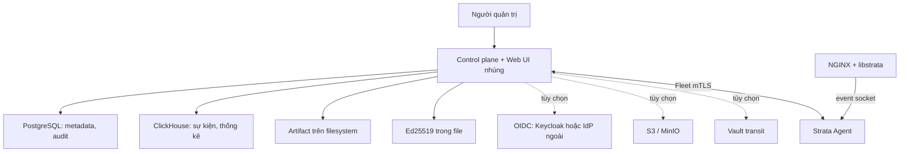

# Kế hoạch triển khai · Strata Compact và quản trị vận hành

Trạng thái: **PO duyệt ngày 19/10/2026, ưu tiên trước giai đoạn B gốc**. Lập ngày 19/10/2026, Claude Code (strata-59), dựa trên
đề xuất "Strata dễ cài, dễ quản trị" và đối chiếu với code trên `main` (`b1ad81e`).

Quyết định của PO ngày 19/10/2026 khi giao viết tài liệu này:

1. **Giữ PostgreSQL** làm kho metadata, không chuyển sang SQLite. Mục A03–A04 (tách
   persistence, SQLite) và phần migration PostgreSQL → SQLite của A09 bị bỏ.
2. **B03 (quản lý cấu hình NGINX) làm sau**, không nằm trong kế hoạch này.
3. Các phần còn lại viết thành kế hoạch triển khai chi tiết, kèm lỗi và lỗ hổng có thể phát
   sinh.

Quyết định tiếp theo cùng ngày (PO: "ưu tiên kế hoạch này, không bật CI GitHub, còn lại tự
quyết"):

4. Kế hoạch này **ưu tiên trước** giai đoạn B gốc (canary, enforce trên route thí điểm).
5. **Không bật CI GitHub.** Mọi PR qua cổng kiểm cục bộ (mục 8a) trước khi merge.
6. Mã nhiệm vụ chính thức là `CP-*` như trong tài liệu này; bảng nhiệm vụ nằm ở `AGENTS.md`.
7. Gói backup mã hóa bằng `filippo.io/age` (passphrase, scrypt).
8. Hai lỗ hổng hiện có (subject OIDC, tên policy có dấu chấm) sửa trước, thành hai PR nhỏ:
   `CP-SEC-01`, `CP-SEC-02`.
9. Bảng thành phần control plane trong `nginx-module.md` sửa theo kiến trúc mục 2.

## 1. Hiện trạng đo trên code

| Hạng mục | Hiện trạng | Hệ quả cho kế hoạch |
| --- | --- | --- |
| Metadata | PostgreSQL, 24 migration, 28 bảng; 21 file `control-plane/store`, khoảng 7.500 dòng gồm `localauth`; dùng `FOR UPDATE`, `SKIP LOCKED`, advisory lock, `jsonb`, `ON CONFLICT` | Giữ nguyên. Chỉ gia cố (mục A03) |
| Cấu hình | 55 cờ trong `control-plane/cmd/server/main.go` (807 dòng) và khoảng 10 biến môi trường `STRATA_*` | A02: file YAML có kiểm tra |
| Xác thực | OIDC bắt buộc trừ khi `-local-auth`; local auth đã có: argon2id, session `stl_…`, khóa sau 5 lần sai, giới hạn theo IP, subject `local:<tên>`; admin đầu tiên lấy từ `STRATA_LOCAL_ADMIN_PASSWORD` | A05, A06: đổi mặc định, thêm `strata init` |
| Artifact | Interface `Objects` 4 hàm (`Put`, `Get`, `Open` có offset, `List`), chỉ có S3/MinIO | A07: adapter filesystem |
| Ký bundle | File seed Ed25519 hoặc Vault transit | A07: file là mặc định |
| UI | Container nginx riêng (`deploy/lab/ui.Dockerfile`), proxy `/v1` tới control plane, `/config.json` mặc định trỏ Keycloak của lab | A08: nhúng vào binary |
| Sự kiện | ClickHouse; `-in-memory` cho phát triển; agent có spool khi gửi lỗi | A08: trạng thái suy giảm rõ |
| Lab/staging | 14 dịch vụ chạy liên tục trong `deploy/lab/compose.yaml`, chưa kể 5 job khởi tạo (gồm Keycloak, Vault, MinIO, Grafana, VictoriaMetrics, vmalert, UI); 15 script lấy token từ Keycloak | A09: compose Compact 3 dịch vụ; script giữ đường Keycloak |
| Nhiều control plane | SQL viết cho nhiều bản (advisory lock, `SKIP LOCKED`) nhưng presence của Fleet, canary monitor, bộ ghi request theo policy nằm trong RAM của từng tiến trình | Compact = một control plane hoạt động; ghi rõ trong tài liệu |
| Chế độ Lite | Agent standalone, gói systemd và installer đã có (`nginx-module.md` § Chế độ Lite) | Không xây lại |
| Exception, ghi chú sự kiện, staging signature, vòng đời rule, chi phí rule | Đã có một phần: `exceptions:fromBlockId`, `store/event_annotations.go`, `store/staging*.go`, `strata-rules lifecycle`, `ingest/rulecost.go` | Đợt C nối tiếp, không làm lại |

### 1a. Phần đã có trên main từ các luồng khác (đối chiếu 20/10/2026)

Main không dừng ở tuần 13: chuỗi remediation (`docs/reports/remediation-tracker.md`,
`branch-consolidation.md`) và các tuần 14–21 (`docs/reports/w17-w21-integration.md`, phiên
strata-b9) đã vào main. Con trỏ tuần trong `AGENTS.md` không theo kịp; các tracker trên là nguồn
trạng thái. Những phần dưới đây kế hoạch **dùng lại, không làm lại**:

| Đã có | Bằng chứng | Liên quan |
| --- | --- | --- |
| Machine credential (service account, token có scope/hạn) | PR #223–#229 | A05 |
| Lịch sử audit bền, lọc, trang Audit | PR #236–#238, `ui/src/pages/AuditPage.tsx` | C03 |
| Exception từ Block ID: phạm vi chính xác, TTL, etag, `request_id`, replay, bốn mắt, runtime | M2 (#138–#155) | C01, C02 |
| Báo FP bền (annotation PostgreSQL) | M1 (#122, #123) | C01 |
| Duyệt gắn replay đã xem (`expected_replay_id`), provenance snapshot | M5 (#124–#142) | B04 |
| M4: tự hạ mức chặn theo opt-in, staging writer ghi vào object storage | M4 (#169–#203) | A07, B04 |
| GeoIP: MMDB bất biến theo phiên bản trong object storage, con trỏ `geoip/latest.json` ghi đè mỗi lần cập nhật; bản đồ, timeline, SSE | W17-G2-01, W18-G2-01, W18-F-01 | A07, A08 |
| Dải IP crawler tải về lưu trong object storage | W18-G2-02 | A07 |
| Lite: agent standalone, gói, installer | W19, `standalone-*.md` | Không đổi |
| Go 1.26.9 bắt buộc | PR #239 | A07 (`os.Root`) |

Chưa có: health router (PR #175/#176 đã đóng, không merge) nên B05 vẫn làm từ đầu.

Đang làm ở phiên khác, kế hoạch phải tránh xung đột: CRS PL2 (strata-b9) sẽ sửa
`control-plane/policy/spec.go`, `compiler.go`, proto admin và policy editor; CP-SEC-02 cũng sửa
`spec.go`, nên báo strata-b9 để rebase.

## 2. Kiến trúc mục tiêu

| Thành phần | Mặc định Compact | Tùy chọn |
| --- | --- | --- |
| Metadata | PostgreSQL đi kèm (một container, volume riêng) | PostgreSQL ngoài, có HA |
| Sự kiện | ClickHouse đi kèm | ClickHouse ngoài hoặc cụm |
| Xác thực | Local auth | OIDC (Keycloak, IdP khác), chạy cùng local |
| Artifact | Filesystem | S3 / MinIO |
| Ký bundle | File Ed25519 | Vault transit |
| UI | Nhúng trong control plane | Reverse proxy ngoài |
| Giám sát | `/metrics`, `/healthz`, `/readyz`, trang Sức khỏe | Grafana, VictoriaMetrics, vmalert |

**Giới hạn Compact**: một control plane hoạt động. Lý do không chỉ là đơn giản hóa: trạng thái
Fleet nằm trong RAM của tiến trình (mục 1). A03 thêm cơ chế ngăn bản thứ hai vô tình nhận ghi.

## 3. Thứ tự và phụ thuộc

Mã nhiệm vụ chính thức `CP-*` (PO 19/10).

| Bước | Mục | Cần trước | Điều kiện chuyển tiếp |
| --- | --- | --- | --- |
| 0 | CP-SEC-01, CP-SEC-02 (hai lỗ hổng hiện có) | — | Merge, có test |
| 1 | A01 Kiểm kê, đo nền | — | Danh mục dữ liệu, bất biến, số đo nền được duyệt |
| 2 | A02 Cấu hình YAML | A01 | Cờ cũ và YAML cho cùng cấu hình hiệu lực |
| 3 | A03 Gia cố PostgreSQL | A01 | Deploy không giữ lock khi build; chặn control plane thứ hai |
| 4 | A05 Local auth mặc định, `strata init` | A02 | Cài mới không cần IdP |
| 5 | A06 OIDC tùy chọn | A05 | Local-only và local+OIDC đạt e2e |
| 6 | A07 Artifact filesystem, file signer | A02, A03 | Deploy/rollback không cần MinIO, Vault |
| 7 | A08 UI nhúng, ClickHouse suy giảm rõ | A02 | Không cần container UI |
| 8 | A09 Backup/restore, đóng gói Compact | A03–A08 | Cài sạch và restore trên lab sạch đạt |
| — | **Mốc Compact Preview** | bước 0–7 | |
| — | **Mốc Compact Stable** | bước 8 + fault test mục 8 | |
| 9 | B02 Inventory, tương thích | Compact Preview | |
| 10 | B01 Ứng dụng, quyền theo phạm vi | B02 | |
| 11 | B04 Luồng phát hành thống nhất | B01, B02 | |
| 12 | B05 Sức khỏe, `strata doctor` đầy đủ | B02 | |
| — | **Mốc Managed Operations** | bước 9–12 | |
| 13 | C03 Privacy, bảo mật quản trị | A05 | Nên làm sớm, không chờ B |
| 14 | C01, C02, C04 | B01 | |
| 15 | C05 API discovery | C03, duyệt pháp chế cho telemetry | |

Ước lượng thời gian chốt sau A01. Kế hoạch này ưu tiên trước giai đoạn B của lộ trình gốc
(PO 19/10); không đổi đường đi request và định dạng bundle.

## 4. Đợt A · Compact

### A01 · Kiểm kê và đo nền

**Việc**

1. Danh mục dữ liệu: mỗi bảng PostgreSQL, mỗi loại file (bundle, mẫu replay, khóa, PKI), mỗi
   trạng thái trong RAM (presence, canary monitor, hàng đợi lệnh, bộ ghi request theo policy)
   kèm owner, nơi lưu, có cần backup, cách khôi phục.
2. Danh sách bất biến phải giữ, kèm test đang bảo vệ từng cái:
   - etag khi sửa policy (`TestPolicyEditAndDeploy`);
   - bốn mắt theo `sub` và CHECK trong DB (`TestFourEyes`, `TestFourEyesInPostgres`);
   - duyệt cần replay DONE (`TestApproveNeedsADoneReplay`);
   - deploy chỉ lấy bản đã duyệt;
   - enrollment token dùng một lần;
   - version bundle tăng nghiêm ngặt;
   - `request_id` chống tạo trùng (advisory lock theo `hashtextextended`);
   - audit commit cùng thay đổi.
3. Đo nền trên máy lab (nhân 6–10): RAM/CPU idle của từng dịch vụ, ingest 1.000 sự kiện/s,
   truy vấn Tổng quan 7 ngày, compile và replay đồng thời; thời gian cài từ đầu và dung lượng
   đĩa sau 7 ngày. Ghi lệnh, output và giới hạn của số đo.
4. Danh sách mâu thuẫn tài liệu cần PO sửa: con trỏ tuần trong `AGENTS.md` (ghi tuần 8),
   phạm vi trong `CLAUDE.md` (khối A3), bảng thành phần control plane trong `nginx-module.md`
   (PostgreSQL HA bằng Patroni, S3, NATS).

**Nghiệm thu**: `docs/reports/cp-a01.md` có đủ bốn phần; mỗi bất biến có ít nhất một test.

### A02 · Một file cấu hình

**Thiết kế**

- File `/etc/strata/config.yaml`, có trường `version: 1`. Mỗi cờ hiện có có một khóa YAML
  tương ứng; bảng ánh xạ cờ ↔ khóa nằm trong tài liệu và trong test.
- Thứ tự ưu tiên: cờ dòng lệnh được truyền tường minh → biến môi trường có hỗ trợ → YAML → mặc
  định. "Được truyền tường minh" xác định bằng `flag.Visit`, không so với giá trị mặc định.
- Secret chỉ đọc từ file (`*_file`) hoặc biến môi trường, không viết thẳng trong YAML. Khóa
  secret viết thẳng trong YAML bị từ chối khi kiểm tra.
- Lệnh: `strata-control-plane config validate`, `config show --effective` (secret hiện
  `<redacted>` và nguồn của từng giá trị: flag, env, file, default).
- Mỗi khóa đánh dấu "cần restart" hay "đổi được khi chạy"; giai đoạn đầu mọi khóa cần restart.
- HTTP quản trị và Fleet mTLS giữ hai cổng riêng.

**Việc**: package `control-plane/config` (struct, nạp YAML bằng decoder bật `KnownFields`,
kiểm tra, merge), đổi `main.go` sang đọc struct; giữ cờ cũ; test bảng ánh xạ.

**Nghiệm thu**: cùng cấu hình viết bằng cờ và bằng YAML cho `config show --effective` giống
nhau; cấu hình sai dừng với thông báo chỉ đúng khóa; không secret nào trong log khởi động.

**Lỗi và lỗ hổng có thể phát sinh**

| Rủi ro | Giảm thiểu |
| --- | --- |
| Khóa gõ sai bị bỏ qua lặng lẽ (`replay_timout`) | `KnownFields(true)`; test với khóa lạ |
| Thứ tự ưu tiên gây bất ngờ: biến môi trường cũ còn trong unit systemd ghi đè YAML | `config show` ghi nguồn của từng giá trị; `doctor` cảnh báo khi env ghi đè YAML |
| Lộ secret qua `config show`, log, thông báo lỗi parse (in nguyên dòng) hoặc panic | Kiểu `Secret` có `String()` trả `<redacted>`; thông báo lỗi chỉ ghi tên khóa; test grep log |
| File secret đọc được bởi người khác, hoặc là symlink tới file không mong muốn | Kiểm tra quyền (không cho nhóm/khác đọc), chủ sở hữu, `O_NOFOLLOW` |
| Đường dẫn tương đối hiểu theo thư mục làm việc khác nhau giữa systemd và tay | Đường dẫn tương đối tính từ thư mục của file cấu hình |
| Duration/kích thước sai đơn vị (`timeout: 10` là ns) | Bắt buộc có đơn vị; từ chối số trần |
| Hai nguồn cùng bật một backend xung đột (`signer: vault` nhưng có `key_file`) | Kiểm tra tổ hợp backend |

### A03 · Gia cố PostgreSQL (thay cho A03–A04 cũ)

**Việc**

1. **Deploy tuần tự, chờ có giới hạn** (điều chỉnh khi làm, 20/10, theo quyền tự quyết PO giao):
   giữ khóa bundle trong lúc build vì chốt replay kiểm theo bundle đang chạy, và khóa bảo đảm bundle
   đó không đổi tới khi deploy ghi xong; tách thành "đặt chỗ → build → xác nhận" chỉ đổi việc chờ
   thành lỗi mà thêm rủi ro với M4 staging. Thêm giới hạn chờ khóa (`Store.BundleLockWait`, mặc
   định 2 phút): quá hạn trả 409 "another deploy is in progress"; khóa phiên đã có sẵn cơ chế hủy
   kết nối khi không chắc trạng thái. Có test deploy đồng thời (chỗ trống CP-A01 tìm ra).
2. **Một control plane hoạt động**: lease trong PostgreSQL (bảng `control_plane_lease`, migration
   0027: holder `host/pid/ngẫu nhiên`, fencing, hết hạn 30 s, gia hạn mỗi 10 s). Bản thứ hai chờ
   lease hết hạn rồi bỏ cuộc (không khởi động). Bản đang giữ mà mất lease hoặc không gia hạn kịp
   thì thoát. Khởi động lại sau sự cố trên cùng máy giành lại ngay khi tiến trình cũ chắc chắn đã
   chết. Cờ `-single-control-plane` (mặc định bật), `-lease-ttl`.
3. **Phục hồi operation**: đã có cho replay (`ClaimOperation` đánh FAILED khi quá hạn); áp
   cùng cách cho rollout và lệnh node.
4. Pool PostgreSQL có giới hạn kết nối và timeout câu lệnh; mất kết nối thì `/readyz` báo lỗi,
   không treo request.
5. PostgreSQL đi kèm Compact: tham số cho máy nhỏ (`shared_buffers`, `max_connections`),
   healthcheck, volume, quyền thư mục.

**Nghiệm thu**: hai deploy đồng thời không trùng version, không chờ nhau trong lúc build; kill
control plane giữa build không để lại lock hay version treo; bản thứ hai cùng DB ở chế độ
Compact không nhận ghi.

**Lỗi và lỗ hổng có thể phát sinh**

| Rủi ro | Giảm thiểu |
| --- | --- |
| Hai deploy cùng chụp tập version policy rồi bản sau ghi đè kết quả bản trước | Ghi tập version đã build trong bản ghi `BUILDING`; xác nhận kiểm tập đó vẫn là tập đã duyệt mới nhất, nếu không thì đánh FAILED với lý do |
| Version bị nhảy (FAILED để lại khoảng trống) làm script nghĩ là lỗi | Ghi rõ trong API và tài liệu: version tăng nghiêm ngặt, không liên tục |
| Object đã upload nhưng xác nhận lỗi: file mồ côi | Dọn object của bản FAILED theo lịch; không xóa object của bản READY |
| Lease: hai bản cùng nghĩ mình giữ lease khi đồng hồ lệch hoặc DB chậm | Dùng `now()` của PostgreSQL, không dùng đồng hồ máy; fencing token (số lần cấp lease) ghi kèm mỗi thao tác Fleet |
| Advisory lock session-level rò khi kết nối trả về pool lỗi | Bỏ session lock trong đường deploy; chỉ dùng `pg_advisory_xact_lock` |
| Statement timeout cắt ngang migration dài | Timeout riêng cho migration |

### A05 · Local auth mặc định và `strata init`

**Thiết kế**

- `strata init` (lệnh con của binary control plane):
  1. tạo thư mục dữ liệu với quyền 0700, chủ là user dịch vụ;
  2. chạy migration PostgreSQL;
  3. tạo khóa ký bundle, CA của node, chứng chỉ TLS của Fleet khi **chưa có**;
  4. tạo admin đầu tiên: hỏi tương tác (không echo), hoặc đọc `--admin-password-file`;
  5. ghi `config.yaml` mẫu nếu chưa có.
  Chạy lại không ghi đè khóa, tài khoản hay cấu hình; báo những gì đã có.
- Không có mật khẩu mặc định. Biến `STRATA_LOCAL_ADMIN_PASSWORD` giữ cho tương thích nhưng
  `doctor` cảnh báo nếu còn đặt sau lần chạy đầu.
- `strata admin recover --user <tên>`: chạy trên máy control plane với quyền đọc file cấu hình
  và DB, đặt mật khẩu tạm buộc đổi ở lần đăng nhập sau, mở khóa tài khoản, ghi audit kênh
  `system`.
- Bảo vệ admin cuối cùng: không xóa, không hạ vai trò, không khóa vĩnh viễn admin cuối cùng
  còn hoạt động.
- Service account và token có scope/hạn dùng: đã có (machine credential, PR #223–#229); A05
  chỉ đưa vào `strata init` (tạo token đầu tiên cho tự động hóa nếu được yêu cầu).
- Local auth bật mặc định; `-local-auth` giữ cho tương thích.

**Nghiệm thu**: cài mới bằng `strata init` rồi đăng nhập, phân quyền, duyệt bốn mắt (hai tài
khoản local), deploy, không cần IdP.

**Lỗi và lỗ hổng có thể phát sinh**

| Rủi ro | Giảm thiểu |
| --- | --- |
| Hai `init` chạy song song tạo hai bộ khóa khác nhau | Khóa file (`flock`) trên thư mục dữ liệu; tạo file với `O_EXCL` |
| Ghi đè khóa ký khi thư mục bị mount nhầm (rỗng) trên hệ đã có bundle | Nếu bảng `bundles` có dữ liệu mà file khóa mất: dừng, không tự sinh khóa mới |
| Mật khẩu lọt qua lịch sử shell, `ps`, biến môi trường | Chỉ nhận tương tác hoặc file; không nhận mật khẩu qua đối số |
| Kẻ tấn công khóa tài khoản admin bằng cách đăng nhập sai liên tục (DoS) | Giới hạn theo IP đã có; khóa có hạn; `admin recover` mở khóa tại máy |
| Dò tên tài khoản qua thời gian phản hồi hoặc thông báo khác nhau | Luôn tính argon2id (hash giả khi không có user); một thông báo chung |
| `admin recover` thành cửa sau | Chỉ chạy tại máy với quyền đọc DB; ghi audit; mật khẩu tạm một lần, buộc đổi |
| Session không bị thu hồi khi đổi mật khẩu, đổi vai trò hay khóa tài khoản | Thu hồi mọi session của user ở cả ba trường hợp; test riêng |
| Bốn mắt bị qua mặt khi một người có hai tài khoản local | Ngoài kỹ thuật: ghi rõ trong tài liệu vận hành; audit hiện cả hai tài khoản; C03 thêm cảnh báo khi cùng IP/thiết bị duyệt bản mình gửi |

### A06 · OIDC và Keycloak tùy chọn

**Thiết kế**

- Keycloak ra khỏi compose mặc định, vào `deploy/compact/compose.keycloak.yaml` (overlay).
  Lab và staging hiện tại vẫn dùng overlay này, nên 15 script lấy token Keycloak không đổi.
- `/v1/auth/methods` (đã có) quyết định UI hiện SSO; `/config.json` do control plane phục vụ từ
  cấu hình (A08), không còn mặc định trỏ Keycloak của lab.
- Kiểm issuer, audience, chữ ký, hạn dùng (đã có qua `go-oidc`); thêm giới hạn lệch đồng hồ và
  role mapping cấu hình được.
- **Tách định danh local và OIDC** (sửa lỗ hổng hiện có, xem dưới).
- Không cho tắt local auth nếu chưa có ít nhất một tài khoản OIDC có vai trò admin đã đăng nhập
  thành công.

**Nghiệm thu**: e2e local-only, OIDC-only, local + OIDC; bật hay tắt Keycloak chỉ đổi cấu hình,
không build lại.

*Trạng thái 20/10:* phần auth đã có test sẵn (xem dòng CP-A06 trong `AGENTS.md`). Overlay
`compose.keycloak.yaml` chỉ có nghĩa cùng compose Compact, nên làm trong CP-A09 (quyết định khi
làm, theo quyền tự quyết PO giao).

**Lỗi và lỗ hổng có thể phát sinh**

| Rủi ro | Giảm thiểu |
| --- | --- |
| **Hiện có**: principal OIDC dùng nguyên `sub` của token (`auth/oidc.go`), còn tài khoản local là `local:<tên>` và service account `sa:<id>`. Một IdP cấp `sub` dạng `local:admin` (IdP ngoài cho phép đặt sub, hoặc IdP bị chiếm) sẽ trùng định danh với tài khoản đó: audit ghi nhầm người, dùng chung khóa chống trùng request (`subject, request_id`) nên có thể nhận lại kết quả request của người kia, và quyết định bốn mắt dựa trên định danh sai. Không cho một người tự duyệt bản của chính mình | `oidc:` cho mọi subject OIDC; token không có `sub` bị từ chối; migration chuyển các cột subject đã lưu (trừ `audit_log`, giữ nguyên lịch sử); test riêng. Làm ở **CP-SEC-01** |
| Tên hiển thị (`preferred_username`) dùng nhầm cho quyết định phân quyền | Chỉ dùng subject cho phân quyền và bốn mắt (đã đúng); test giữ nguyên |
| Token có audience khác (của ứng dụng khác cùng IdP) được nhận | Bắt buộc `audience`; test token sai audience |
| Redirect URI mở sau đăng nhập | UI chỉ quay về đường dẫn nội bộ (bắt đầu bằng `/`, không `//`) |
| Hai IdP cùng cấu hình, sub trùng nhau | `issuer-id` trong subject |
| Role mapping cấp nhầm admin do claim lồng nhau | Test role mapping với claim thiếu, sai kiểu, mảng rỗng |

### A07 · Artifact trên filesystem và file signer mặc định

**Thiết kế**

- Adapter `policy.FS` thực thi `Objects` (`Put`, `Get`, `Open` có offset cho `FetchBundle`
  tải tiếp, `List` cho mẫu replay).
- `Put` nguyên tử: ghi file tạm trong **cùng thư mục**, `fsync` file, `rename`, `fsync` thư
  mục.
- Hai loại khóa: **bất biến** (bundle, mẫu replay, MMDB theo phiên bản `geoip/<version>/…`,
  bản ghi staging M4): file đã có với hash khác → từ chối, cùng hash → coi như thành công;
  **con trỏ** ghi đè được (hiện có `geoip/latest.json`): chỉ các khóa trong danh sách cho phép,
  ghi đè bằng rename nguyên tử. Người dùng của `Objects` hiện nay: deploy, Fleet (`FetchBundle`),
  replay, GeoIP updater, goodbots, M4 staging writer; mỗi nơi được test với adapter mới.
- Mọi khóa (key) được kiểm từng đoạn: chỉ `[a-z0-9._-]`, không đoạn rỗng, không `.` hay `..`,
  không bắt đầu bằng `/`; mở file theo thư mục gốc (`os.Root`, Go 1.24+) để chặn symlink thoát
  ra ngoài.
- Dọn dẹp: không bao giờ xóa bundle đang active trên node nào, bundle mong muốn của group, và N
  bundle gần nhất cho rollback (N cấu hình được, mặc định 10). Mẫu replay theo số ngày giữ.
- File signer mặc định; Vault là tùy chọn. Nếu DB đã có bundle mà mất khóa: dừng, không sinh
  khóa mới (giống A05). Xoay khóa dùng quy trình hai khóa đã có
  (`tests/e2e/lab-key-rotation.sh`).

**Nghiệm thu**: deploy, rollout, tải tiếp bundle bị ngắt, rollback, replay chạy với
filesystem, không MinIO, không Vault; bundle ký sai bị node từ chối.

*Trạng thái 20/10:* làm xong, báo cáo `docs/reports/cp-a07.md`. Hai điều chỉnh khi làm: manifest
GeoIP theo phiên bản và file `goodbots/<version>.json` ghi đè được như con trỏ (chứa thời điểm
tải, một phiên bản tải lại sau phiên bản khác sẽ ghi lại); deploy gặp số bản đã có file mà chưa
có bản ghi thì nhảy qua thay vì kẹt (không ghi đè, giữ bất biến).

**Lỗi và lỗ hổng có thể phát sinh**

| Rủi ro | Giảm thiểu |
| --- | --- |
| **Hiện có, thành lỗ hổng khi dùng filesystem**: tên policy theo `NamePattern` `^[a-z0-9._-]{1,55}$` cho phép `.` và `..`; tên này nằm trong khóa mẫu replay `replay/v1/<policy>/…` (`replay/store.go`). Với S3 đó chỉ là một chuỗi; với filesystem, policy tên `..` ghi file ra ngoài thư mục replay | Kiểm khóa từng đoạn và dùng `os.Root` (trên); đồng thời siết `NamePattern` không cho tên chỉ gồm dấu chấm, kèm migration kiểm tên cũ |
| Crash giữa ghi file và ghi metadata: file mồ côi, hoặc bản ghi trỏ tới file chưa đủ | Thứ tự: file xong (rename + fsync) rồi mới ghi DB; dọn mồ côi theo lịch |
| Đầy đĩa giữa lúc ghi bundle | Kiểm dung lượng trống trước khi build; lỗi rõ; `/readyz` và trang Sức khỏe cảnh báo trước khi đầy |
| Mẫu replay (traffic đã ẩn danh, vẫn là dữ liệu nhạy cảm) đọc được bởi user khác trên máy | Thư mục 0700, file 0600, chủ là user dịch vụ |
| Dọn nhầm bundle mà node còn cần để rollback | Danh sách giữ lấy từ DB (active, desired, N gần nhất), không theo tuổi file |
| Con trỏ `geoip/latest.json` bị đọc giữa lúc ghi, hoặc trỏ tới phiên bản đã bị dọn | Ghi đè bằng rename nguyên tử; dọn GeoIP không xóa phiên bản mà con trỏ đang trỏ tới |
| Áp quy tắc bất biến cho mọi khóa làm hỏng cập nhật GeoIP | Danh sách khóa con trỏ tường minh, test với GeoIP updater |
| Endpoint tải artifact cho người không đủ quyền | Bundle chỉ đi qua Fleet mTLS (như hiện nay); không thêm endpoint HTTP tải bundle trong Compact |
| Hai control plane ghi cùng thư mục | Lease của A03; cảnh báo nếu thư mục nằm trên NFS |

### A08 · UI nhúng và ClickHouse

**UI**

- `go:embed` thư mục `ui/dist`; Makefile build UI trước control plane; binary ghi phiên bản UI.
- Thứ tự định tuyến: `/v1/*` và `/healthz` cho API (không bao giờ trả `index.html`); file tĩnh
  có hash: `Cache-Control: immutable`; còn lại trả `index.html` với `no-cache`.
- `/config.json` do control plane sinh từ cấu hình (OIDC authority, client id); không có OIDC
  thì không có trường đó.
- Header: `Content-Security-Policy` (không `unsafe-inline` cho script), `X-Frame-Options: DENY`,
  `Referrer-Policy`, `X-Content-Type-Options`. API và UI cùng origin nên CORS mặc định tắt.
- Lợi ích phụ: hết lỗi 502 khi chỉ control plane được tạo lại (nginx của container UI giữ IP cũ,
  gặp trên lab 16/10).

**ClickHouse**

- Giữ ingest, tra Block ID, timeline, geo, aggregate. Migration schema ClickHouse đi cùng phiên
  bản sản phẩm (hiện `schema.sql` chỉ chạy khi tạo volume, phần sau dùng `Ensure*`): gom về một
  danh sách migration có số thứ tự.
- ClickHouse lỗi: `/readyz` báo "events degraded"; API thống kê trả lỗi 503 có mã riêng, UI hiện
  "nguồn dữ liệu không sẵn sàng", **không** hiện 0 sự kiện; đăng nhập và sửa policy vẫn chạy.
- Ingest khi ClickHouse lỗi: control plane trả lỗi có thể thử lại để agent giữ trong spool (đã
  có); kiểm lại bằng fault test (mục 8).

**Lỗi và lỗ hổng có thể phát sinh**

| Rủi ro | Giảm thiểu |
| --- | --- |
| SPA fallback trả `index.html` 200 cho đường dẫn API gõ sai: client tự động hiểu nhầm | `/v1/` không bao giờ rơi vào fallback; test |
| Trình duyệt giữ UI cũ sau nâng cấp, gọi API mới | `index.html` no-cache; asset có hash |
| XSS qua dữ liệu sự kiện (URI, header, snippet do kẻ tấn công điều khiển) | React escape mặc định; cấm `dangerouslySetInnerHTML` bằng lint; CSP chặn script inline |
| Clickjacking trang duyệt (lừa bấm "Duyệt") | `X-Frame-Options: DENY`, `frame-ancestors 'none'` |
| Truy vấn ClickHouse nặng từ UI làm chậm ingest | Giới hạn cửa sổ (đã có 31 ngày), `max_execution_time`, user ClickHouse riêng cho truy vấn |
| Hiện "0 sự kiện" khi ClickHouse mất kết nối, người vận hành tưởng hệ thống sạch | Phân biệt lỗi với kết quả rỗng ở API và UI |

### A09 · Backup, restore và đóng gói

**Backup**

- `strata backup --out <thư mục>`:
  1. `pg_dump -Fc` (snapshot nhất quán);
  2. sau đó mới chép artifact: artifact bất biến và được ghi trước bản ghi DB (A07), nên mọi
     bundle mà bản dump tham chiếu đều đã có file;
  3. khóa ký, CA node, chứng chỉ, cấu hình;
  4. manifest có sha256 từng file, phiên bản sản phẩm, phiên bản migration.
- Gói có khóa riêng tư được mã hóa bằng `filippo.io/age` (passphrase, scrypt; PO 19/10);
  passphrase do người vận hành giữ, đọc từ file hoặc nhập tương tác.
- ClickHouse backup theo quy trình riêng (`BACKUP … TO Disk`), tùy chọn; tài liệu nói rõ mất
  ClickHouse là mất lịch sử sự kiện, không mất cấu hình.

**Restore**: `strata restore` chỉ chạy khi control plane dừng; kiểm manifest và phiên bản;
restore vào lab sạch là bài diễn tập bắt buộc trước Compact Stable.

**Đóng gói**: `deploy/compact/compose.yaml` với 3 dịch vụ: control plane (UI nhúng),
PostgreSQL, ClickHouse. Overlay: Keycloak, MinIO, Vault, giám sát. Healthcheck, volume, quyền
file, giới hạn tài nguyên; hướng dẫn nâng cấp và xử lý đầy đĩa. Node vẫn cài bằng gói deb/rpm đã
có.

**Lỗi và lỗ hổng có thể phát sinh**

| Rủi ro | Giảm thiểu |
| --- | --- |
| **Restore làm version bundle đi lùi**: DB cũ có version tối đa 40, node đang chạy 45; bundle mới đánh số 41 bị node từ chối vì cũ hơn bản đang chạy | Sau restore, sequence version bắt đầu từ max(version trong DB, version node báo trong heartbeat) + 1; `restore` cảnh báo và yêu cầu xác nhận |
| Restore CA node cũ: node đã enroll sau thời điểm backup có chứng chỉ do CA mới (nếu đã xoay) cấp | Tài liệu: restore kèm danh sách node cần enroll lại; Fleet báo node có chứng chỉ không xác minh được |
| Gói backup chứa khóa ký và CA bị lộ | Mã hóa bắt buộc khi có khóa; quyền 0600; không ghi passphrase vào log |
| Restore chồng lên hệ đang chạy | Kiểm lease (A03) và từ chối khi control plane đang chạy |
| Backup chạy giữa lúc deploy: bản ghi `BUILDING` | Restore đánh FAILED mọi bản `BUILDING` |
| Nâng cấp PostgreSQL major trong compose làm mất dữ liệu (volume khác định dạng) | Ghim phiên bản; hướng dẫn `pg_dump`/`pg_restore` khi nâng major; không nâng tự động |
| Đầy đĩa do ClickHouse (TTL chưa kịp chạy) làm PostgreSQL cùng đĩa ngừng ghi | Khuyến nghị volume riêng; cảnh báo dung lượng ở B05 |

## 5. Đợt B · Quản trị theo ứng dụng (không gồm B03)

### B02 · Inventory và tương thích (làm trước B01)

- Node báo trong heartbeat: phiên bản agent, module, ABI, NGINX, OS, danh sách capability của
  module (ví dụ: snippet 2048/4096, `max_args`, section `HYPERSCAN_BLOCK`). Phần đã có:
  `agent_version`, `cert_not_after_seconds`, bundle active.
- Bundle ghi danh sách capability nó cần (compiler biết khi nào dùng tính năng mới). Deploy
  kiểm trước: node trong group thiếu capability → từ chối với danh sách node và lý do.
- Desired so với actual cho từng node; rollout chỉ coi là xong khi node xác nhận ACTIVE (đã có
  trong rollout), hiện node lệch trên Fleet.
- Theo dõi hạn chứng chỉ Fleet, cảnh báo trước 7 ngày.

**Lỗi và lỗ hổng**: dữ liệu do node tự báo có thể sai hoặc giả (node bị chiếm): chỉ dùng để
cảnh báo và chặn deploy, không dùng để cấp quyền. Capability thiếu ở agent cũ (chưa báo) phải
hiểu là "không có", không phải "có tất cả".

### B01 · Ứng dụng, môi trường và quyền theo phạm vi

- Bảng mới: `applications` (owner), `environments`, `app_routes` (host, tiền tố đường dẫn →
  policy), liên kết policy, connector group, schema.
- Role binding có phạm vi: toàn hệ thống, ứng dụng, hoặc ứng dụng + môi trường. Mọi API danh
  sách và thống kê lọc theo phạm vi người gọi.
- Màn hình ứng dụng: mức bảo vệ (enforce/shadow/không kiểm đủ), sự kiện, thay đổi gần đây.

**Lỗi và lỗ hổng**

| Rủi ro | Giảm thiểu |
| --- | --- |
| IDOR: người có quyền ứng dụng A đọc sự kiện, policy hoặc thống kê của B qua tham số (`policy_id`, Block ID) | Kiểm phạm vi tại tầng store/handler cho cả GET từng bản ghi, không chỉ danh sách; test ma trận vai trò × phạm vi |
| Policy dùng chung cho nhiều ứng dụng: người của A sửa policy làm ảnh hưởng B | Sửa policy dùng chung cần quyền trên mọi ứng dụng dùng nó |
| Thống kê tổng hợp (Tổng quan) lộ số liệu ngoài phạm vi | Truy vấn ClickHouse luôn có điều kiện phạm vi |
| Bốn mắt theo phạm vi: approver của ứng dụng khác duyệt | Quyền duyệt kiểm theo phạm vi của policy |

### B04 · Luồng phát hành thống nhất

Soạn → kiểm tra → replay → xem tác động → duyệt → canary → triển khai → theo dõi → rollback,
dùng các phần đã có: replay, bốn mắt, duyệt gắn replay đã xem (`expected_replay_id`, M5),
provenance snapshot, rollout, canary, M4 staging.

- Đối tượng `release`: tập version policy, phiên bản rule pack, schema, bundle; trạng thái
  từng node.
- Rollback = deploy lại **cùng tập** của release trước thành bundle mới (version mới, nội dung
  cũ), không quay version.
- Điều kiện dừng canary cấu hình được (đã có monitor W12); so trước/sau cùng phương pháp đo.

**Lỗi và lỗ hổng**

| Rủi ro | Giảm thiểu |
| --- | --- |
| Replay lỗi thời: duyệt dựa trên replay so với bundle 41, nhưng lúc deploy bundle đang chạy là 43 | Pin replay đã xem có sẵn (M5); bổ sung: khi `baseline_bundle` của replay khác bundle đang chạy lúc deploy, đòi replay lại hoặc cảnh báo rõ |
| Rollback chỉ lùi policy mà quên rule pack, ra tổ hợp chưa từng chạy | Release giữ cả phiên bản pack; rollback lấy nguyên tập |
| Gọi API deploy trực tiếp bỏ qua luồng release | Kiểm tra ở server (đã có cho bốn mắt); release chỉ là lớp trên |
| Coi block rate tăng là false positive | Báo cáo tách theo nhãn mẫu (benign/tấn công) như replay; không tự kết luận |

### B05 · Sức khỏe hệ thống và `strata doctor`

- Health router trước đây (PR #175/#176) đã đóng, không merge: làm mới, có thể lấy lại phần
  hợp đồng dữ liệu bền của #175 sau khi review.
- Trang Sức khỏe: request kiểm đủ/không đủ, shadow, fail-open, breaker (đã có số liệu
  RV-N-01); body bỏ qua; node mất kết nối hoặc lệch phiên bản; ingest lag, spool, sự kiện bị bỏ;
  đĩa; PostgreSQL; operation lỗi; chứng chỉ sắp hết hạn; độ tươi của từng nguồn dữ liệu.
- `strata doctor`: kiểm từng thành phần, gợi ý cách xử lý; `--support-bundle` xuất log, cấu
  hình hiệu lực, phiên bản, số đếm.

**Lỗi và lỗ hổng**: support bundle lộ secret hoặc dữ liệu cá nhân (log có IP, URI) → che bằng
cùng bộ lọc của A02 và C03, có danh sách trường được phép, test grep secret. Trang báo "xanh" khi
thiếu dữ liệu → mỗi ô ghi thời điểm dữ liệu mới nhất, quá hạn thì xám.

## 6. Đợt C · Vận hành SOC và rule

### C03 · Privacy và bảo mật quản trị (làm sớm)

- Che dữ liệu trước khi lưu và xuất, áp cho ClickHouse, JSONL/syslog của Lite, replay, export,
  webhook, support bundle; dùng chung cài đặt privacy của policy (P-01 đã có).
- MFA TOTP cho tài khoản local; mã khôi phục lưu dạng hash; quản lý session (xem, thu hồi).
- Audit: lịch sử bền và trang Audit đã có (#236–#238); làm thêm xuất bản sao ra hệ thống ngoài
  (syslog/webhook). Không gọi audit trong PostgreSQL là "chống sửa".

**Lỗi và lỗ hổng**: TOTP dùng lại trong cùng cửa sổ (lưu mã đã dùng); MFA bị qua mặt bằng token
service account (service account không đăng nhập UI, scope tối thiểu); mã khôi phục lưu rõ; xuất
dữ liệu bỏ qua che (mọi đường xuất đi qua một hàm); viewer xem IP đầy đủ qua đường mới (kiểm
`events:read_sensitive` ở mọi API mới).

### C01 · Điều tra sự kiện tới hành động

- Đã có: báo FP bền (M1), exception từ Block ID qua replay và bốn mắt (M2).
- Làm mới: saved search và link chia sẻ bộ lọc; phân công và trạng thái xử lý sự kiện (mở rộng
  `event_annotations`); nhóm sự kiện tương tự; tạo rule hoặc rate limit từ sự kiện qua luồng
  duyệt (rate limit chỉ đo theo quyết định PO 17/10, không tự bật); xuất bằng chứng theo bộ
  lọc.

**Lỗi và lỗ hổng**: CSV injection trong file xuất (ô bắt đầu bằng `=`, `+`, `-`, `@`): giữ cách
xử lý của `ui/src/lib/csv.ts` cho mọi đường xuất mới, kể cả xuất phía server; link chia sẻ chứa
bộ lọc nhạy cảm (IP) → link chỉ mở được khi người nhận có quyền tương ứng; xuất lớn làm nghẽn
ClickHouse → giới hạn số dòng và chạy như operation; ghi chú chứa dữ liệu cá nhân → áp retention.

### C02 · Rule pack và exception có vòng đời

- Danh mục rule theo nguồn, CVE, loại tấn công, phiên bản (nối `rulecat`, `strata-rules
  lifecycle`); ứng dụng nào đang dùng; diff và changelog khi cập nhật pack (`strata-rules
  release`); exception có phạm vi app/route/method/tham số/rule, lý do, owner, hạn dùng, duyệt;
  cảnh báo exception quá rộng, sắp hết hạn, không còn khớp; chi phí rule (W13-R-02).

**Lỗi và lỗ hổng**: exception hết hạn vẫn nằm trong bundle đang chạy tới lần deploy sau → engine
kiểm hạn lúc chạy (exception đã có `ExpiresUnixMS`; kiểm ở A01 xem engine có tôn trọng không) và
lịch build lại; exception quá rộng (mọi rule, đường dẫn `/`) → chặn hoặc bắt duyệt cấp cao; regex
trong exception gây chậm → chỉ cho regex tuyến tính (quy tắc của dự án).

### C04 · Cảnh báo và báo cáo

- Cảnh báo: deploy lỗi, node offline, fail-open tăng, spool/đĩa gần đầy, ingest lag, sự kiện bị
  bỏ, chứng chỉ, backup lỗi, exception sắp hết hạn. Webhook có retry giới hạn, gộp, cooldown,
  acknowledge. Báo cáo định kỳ theo ứng dụng.

**Lỗi và lỗ hổng**

| Rủi ro | Giảm thiểu |
| --- | --- |
| SSRF qua URL webhook (trỏ tới `169.254.169.254`, mạng nội bộ, `localhost` của control plane) | Chặn địa chỉ private/link-local/loopback sau khi phân giải DNS (và kiểm lại khi kết nối, chống DNS rebinding) trừ khi nằm trong allowlist; không theo redirect |
| Lộ payload hoặc secret trong nội dung cảnh báo | Mặc định không gửi URI, snippet, IP đầy đủ |
| Người nhận giả mạo cảnh báo | Ký HMAC nội dung webhook |
| Bão cảnh báo khi một sự cố lan nhiều node | Gộp theo nguyên nhân, cooldown |

### C05 · API discovery

- Đối chiếu endpoint quan sát với OpenAPI; phát hiện endpoint chưa quản lý; đề xuất method,
  content type, giới hạn từ mẫu đủ điều kiện; mọi đề xuất qua diff, replay, duyệt; không tự bật
  block.
- Cần telemetry riêng (sự kiện vi phạm không đại diện cho toàn bộ lưu lượng): cùng loại dữ liệu
  với mẫu replay, nên cần **duyệt pháp chế** như W11-G2-01.

**Lỗi và lỗ hổng**: kẻ tấn công "dạy" hệ thống bằng request giả để endpoint độc hại lọt vào đề
xuất → chỉ đề xuất từ mẫu có phản hồi 2xx của backend, nhiều nguồn khác nhau, và luôn qua duyệt;
bùng số lượng đường dẫn (tham số trong path) → gom mẫu `/users/{id}`, giới hạn số endpoint; dữ
liệu cá nhân trong path/query → che trước khi lưu.

## 7. Rủi ro chung

| Rủi ro | Giảm thiểu |
| --- | --- |
| CI GitHub không chạy (PO 19/10 quyết không bật): thay đổi lớn chỉ kiểm cục bộ dễ lọt lỗi (đã xảy ra: gofmt trên main sau #102) | Cổng kiểm cục bộ bắt buộc (mục 8a); kiểm mã thoát của lệnh, không lọc output |
| Hồi quy các bất biến vừa làm (bốn mắt, replay gate, etag) khi đổi auth và deploy | Danh sách bất biến A01 thành test bắt buộc trong CI |
| Đổi mặc định làm hỏng staging/prod-sim đang chạy (Keycloak, MinIO, Vault) | Staging/prod-sim dùng overlay, không đổi; chuyển mặc định chỉ cho cài mới |
| Kế hoạch chạy cùng giai đoạn B (enforce) và Gate A chưa đạt | PO chốt ưu tiên (mục 9); không đổi đường đi request và bundle format trong kế hoạch này |
| Tài liệu thiết kế mâu thuẫn với code mới | Mỗi PR sửa `nginx-module.md` phần tương ứng |

## 8. Kiểm chứng

| Nhóm | Bằng chứng bắt buộc |
| --- | --- |
| Đồng thời | Deploy song song, duyệt song song, enrollment, etag, `request_id` (Go `-race`, PostgreSQL thật) |
| Auth | Local-only, OIDC-only, kết hợp; RBAC, bốn mắt; subject OIDC có namespace; token sai audience |
| Phục hồi | Kill control plane giữa build, giữa rollout, giữa replay; restore trên lab sạch; version không đi lùi sau restore |
| Sự cố | Đầy đĩa, PostgreSQL mất kết nối, ClickHouse down, agent offline, artifact hỏng hash |
| Artifact | Path traversal (tên `..`, symlink), ghi đè khác hash, tải tiếp từ offset |
| Sự kiện | Spool/retry khi ClickHouse down, chống trùng, bộ đếm bỏ sự kiện, UI phân biệt lỗi và rỗng |
| Privacy | Grep secret và dữ liệu cá nhân trong log, `config show`, support bundle, export, webhook |
| Web | CSP, chống clickjacking, SPA fallback không nuốt `/v1` |
| Hiệu năng | So với số đo nền A01 (idle, ingest, truy vấn, compile/replay) |

Mỗi tiêu chí ghi lệnh, output và giới hạn kết luận. Không đánh dấu xong chỉ vì luồng thành công
chạy được.

## 8a. Cổng kiểm cục bộ (thay CI)

Mỗi PR chạy trên nhân 6–10 và dán kết quả vào mô tả PR. Phần nào không đụng thì ghi rõ lý do bỏ.

| Phạm vi đổi | Lệnh |
| --- | --- |
| Go (control plane, agent, tools) | `make test-go` với `STRATA_TEST_POSTGRES_DSN` và ClickHouse thật; kiểm **mã thoát** và dòng `issues` của golangci-lint, không chỉ dòng `ok` |
| Proto | `make check-proto` |
| E2E | `make e2e-go`; test hỏng phải chạy lại riêng và ghi lại |
| UI | `build/ui.sh` (lint, vitest, build, Playwright) |
| Rust, C | `make test NGINX_VERSION=1.30.5`, `make check-c-lines` |
| Script | shellcheck `-S warning` |
| Lab | `deploy/lab/smoke.sh` cho thay đổi chạm control plane, auth, deploy (lab của phiên W10: hỏi trước, khôi phục từ worktree detached ở `origin/main`) |

## 9. Những gì PO đã chốt (19/10/2026)

1. Ưu tiên kế hoạch này trước giai đoạn B gốc.
2. Mã nhiệm vụ `CP-*`; cập nhật `AGENTS.md`, `CLAUDE.md` (trong PR này).
3. Bảng thành phần control plane trong `nginx-module.md` sửa trong PR này.
4. Gói backup mã hóa bằng `filippo.io/age`.
5. Hai lỗ hổng sửa trước: `CP-SEC-01` (namespace subject OIDC), `CP-SEC-02` (tên policy và khóa
   artifact).
6. Không bật CI GitHub; cổng kiểm cục bộ mục 8a.
