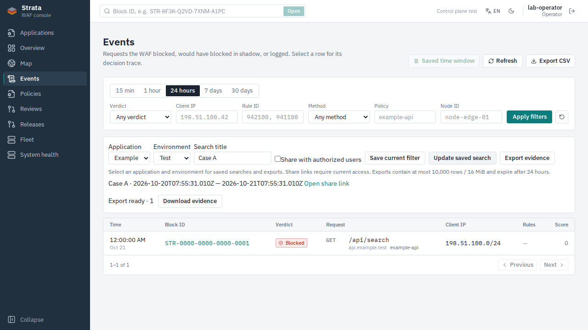
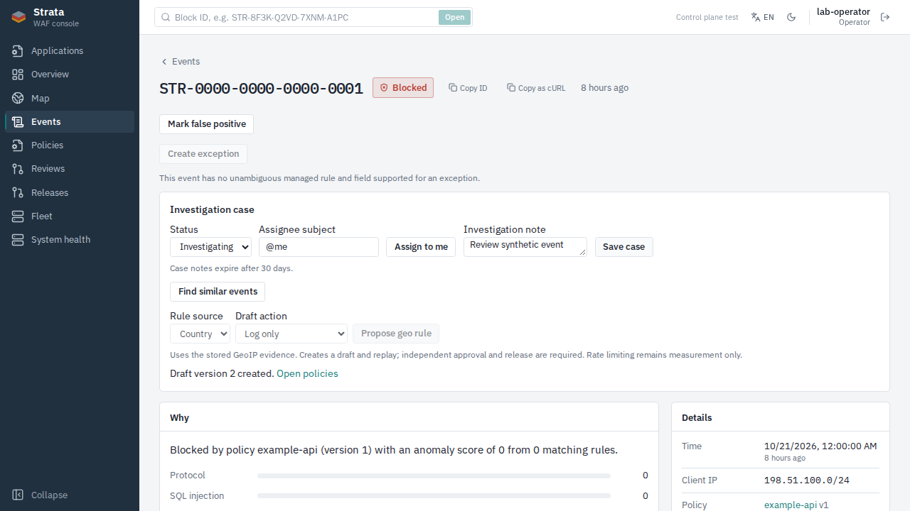

# CP-C01 · Event investigation

Status: code/tests complete; dependent review PRs, not merged. PostgreSQL and ClickHouse remain.
Dependent on the reviewed B baseline and C03 privacy/administrative security stack.

## Behavior

- Saved searches belong to one application/environment, expire after 90 days and
  are private unless explicitly shared. Opaque links contain no filters. Opening,
  executing, listing and editing revalidate current permissions. Sensitive filters
  require `events:read_sensitive`; ownership alone grants no access after revocation.
  A shared query executes within its saved app/environment, not the caller's entire
  event scope. At most 100 active searches per subject; lists page by 50.
- Case metadata extends PostgreSQL `event_annotations`, with independent case etag,
  assignee, open/investigating/resolved state and 30-day notes. Case-only rows do not
  become false positives. Classification and case edits preserve each other. An
  assignee is the caller or a subject explicitly bound to the event's exact route,
  environment and node. Disabled local assignees are rejected. Viewer notes are
  hidden. Retention also runs without artifact storage. Audits omit note/filter
  bodies; bounded idempotent responses expire after 30 days.
- Similar events share exact policy/method/host/path and the first matched rule,
  within 12 hours either side of the source event. Queries retain caller scope and
  return at most 200 events. This is an explainable deterministic group, not a
  claim of semantic or full-traffic similarity.
- Verified stored country/ASN evidence can create a log or block **draft** using
  the current policy etag. It atomically queues replay and keeps ordinary independent
  approval/release gates. Rate limiting remains measurement only. IDs are reserved
  globally across policy histories; a database guard covers every writer and
  concurrent proposals. No bundle/proto/engine format changed.
- Evidence jobs persist separately from replay operations. One worker queries
  pages of 200, bounded to 31 days, 10,000 rows, 16 MiB and five minutes. The upper
  timestamp is pinned to job creation. CSV cells neutralize formulas including
  whitespace/BOM prefixes; quoting preserves row boundaries. Files are private,
  content-addressed and hash-checked, with authenticated owner-only downloads and
  24-hour expiry. Creation, execution, publication, history and download recheck
  scope; a revoked original route invalidates the complete artifact. New permissions
  cannot widen a pending export. Crash leases fence stale workers and retry at most
  three times. Terminal metadata and orphan retry artifacts are purged after expiry; an active
  crash lease may delay physical cleanup by up to six minutes. Downloads expire immediately.
- Events/detail UI exposes saved filters, opaque links, case handling, similar
  events, geo proposals, export status/history and authenticated downloads. Uses
  generated OpenAPI types and English/Vietnamese translations.

## Verification

All commands ran in isolated containers on CPUs 6–10, with PostgreSQL 17.11 and
ClickHouse 25.8.33, without changing shared services.

- `go test -p 1 -race ./...` → exit 0 (`c01-full-go.log`):
  `api 101.663s`, `cmd/server 94.718s`, `fleet 39.550s`, `ingest 30.088s`,
  `localauth 37.479s`, `store 42.322s`.
- Final affected privacy/ownership/retention changes: race tests over API/store/
  investigation → exit 0 (`c01-final-security.log`): `api 4.156s`,
  `store 2.146s`, `investigation 1.152s`.
- `golangci-lint run ./...` → `0 issues.` (`c01-final-lint.log`).
- Exact route query parity and SQL injection rejection tested against real
  ClickHouse; concurrent geo allocations against real PostgreSQL.
- Selected e2e `Test(FleetEnrollConnectRevoke|FourEyes|MigrationsUpDownOnEmptyDatabase|PolicyEditAndDeploy)`
  → exit 0, `56.497s` (`c01-selected-e2e.log`). Migrations go up/down/up.
- UI lint/unit/build → exit 0, **35 files / 266 tests** (`c01-ui-final.log`).
  Final saved-window/unsharing regressions: **2 files / 21 tests**, lint and
  production build passed (`c01-ui-final-security.log`).
- Existing browser regressions: **22 passed**. The initial two new tests failed
  because exact label selectors included select options; corrected the new test
  locators to accessible combobox roles. Final investigation browser tests:
  **2 passed, 12.1s** (`c01-playwright-final.log`), including unsharing and downloads
  with Authorization headers. Screenshots below use synthetic fixtures.
- No Rust/C/proto/bundle format changes; no sanitizer rebuild or benchmark needed.

### Self-review

1. Acceptance: commands/output above cover filters, cases, grouping, drafts and exports.
2. Errors: fail-closed store errors, rollback on audit failure; no raw payload in errors.
3. Bounds: search/page/job/artifact/note/filter limits; context cancellation and retention.
4. Security: fresh RBAC, etag/request IDs, scoped assignees, revocation, formula injection,
   private objects and hash verification; viewer exports mask IP and omit snippets.
5. Scope: control-plane, generated OpenAPI/UI, related tests/design/report only.
6. Lint: Go `0 issues`; TypeScript lint/build passed.

### Ordered review PRs

Start after C03 #335 and review in this order. None of these C01 PRs are merged.

| PR | Branch |
| --- | --- |
| [#336](https://github.com/hieunyit/strata/pull/336) | `codex/cp-c01-persistence` |
| [#337](https://github.com/hieunyit/strata/pull/337) | `codex/cp-c01-geo-ids` |
| [#338](https://github.com/hieunyit/strata/pull/338) | `codex/cp-c01-event-queries` |
| [#339](https://github.com/hieunyit/strata/pull/339) | `codex/cp-c01-evidence-store` |
| [#340](https://github.com/hieunyit/strata/pull/340) | `codex/cp-c01-evidence-worker` |
| [#341](https://github.com/hieunyit/strata/pull/341) | `codex/cp-c01-saved-api` |
| [#342](https://github.com/hieunyit/strata/pull/342) | `codex/cp-c01-rule-proposals` |
| [#343](https://github.com/hieunyit/strata/pull/343) | `codex/cp-c01-evidence-api` |
| [#344](https://github.com/hieunyit/strata/pull/344) | `codex/cp-c01-integration` |
| [#345](https://github.com/hieunyit/strata/pull/345) | `codex/cp-c01-security-tests` |
| [#346](https://github.com/hieunyit/strata/pull/346) | `codex/cp-c01-investigation-contract` |
| [#347](https://github.com/hieunyit/strata/pull/347) | `codex/cp-c01-evidence-contract` |
| [#348](https://github.com/hieunyit/strata/pull/348) | `codex/cp-c01-ui-client` |
| [#349](https://github.com/hieunyit/strata/pull/349) | `codex/cp-c01-search-ui` |
| [#350](https://github.com/hieunyit/strata/pull/350) | `codex/cp-c01-case-ui` |
| [#351](https://github.com/hieunyit/strata/pull/351) | `codex/cp-c01-docs` |

## Operational limits

- CSV covers the stored security-event source, not every request. Late ClickHouse
  arrivals can affect pagination; an evidence file is the returned selection, not
  a transactionally frozen ClickHouse snapshot. `sha256` checks artifact bytes,
  not tamper-proof audit history.
- The worker rechecks local account state and current application bindings. External
  OIDC role changes follow the identity provider/token's existing validation and
  expiry behavior. Download always authenticates the current caller.
- No staging/production/shared-lab operations, benchmarks, real messages or live
  telemetry collection. New PRs await review.
