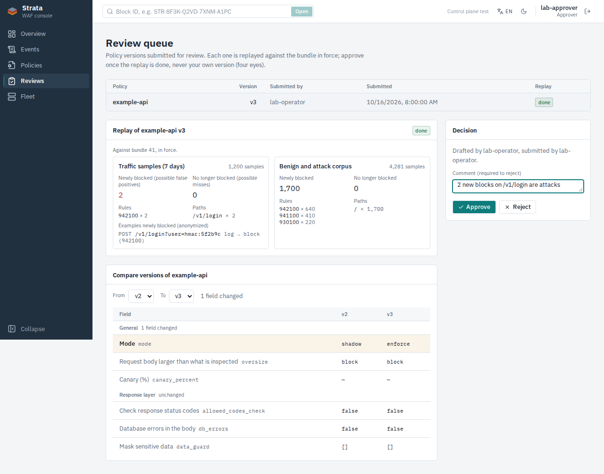

# Báo cáo W13-F-01 · Hàng chờ duyệt

Ngày: 16/10/2026. Người làm: Claude Code (strata-59). Nhánh `W13-F-01-review-queue`.

**Xong khi** (plan): hiển thị bản nháp chờ duyệt kèm kết quả replay và diff; duyệt/từ chối
được. **Đạt** (mục 2).

## 1. Cách làm

| Phần | Ở đâu |
| --- | --- |
| Trang `#/reviews` (mục "Duyệt" trên thanh bên, mọi vai trò xem được): bảng các version SUBMITTED kèm trạng thái replay; chọn một version để xem replay, diff và ô quyết định | `ui/src/pages/ReviewsPage.tsx` |
| Kết quả replay: so với bundle đang chạy, **traffic 7 ngày và corpus tách riêng**; số bị chặn mới (có thể chặn nhầm) và không còn bị chặn (có thể lọt), rule và đường dẫn nhiều nhất, ví dụ đã ẩn danh (chỉ API trả cho vai trò có `events:read_sensitive`) | `ui/src/components/policy/ReplayResult.tsx` |
| Diff: mở sẵn từ bản đã duyệt mới nhất (`approved_version`) tới bản chờ duyệt | `PolicyDiff.tsx` (thêm `initialFrom`, `initialTo`) |
| Duyệt: chỉ approver/admin thấy ô quyết định; nút Duyệt tắt khi replay chưa DONE hoặc người đang xem đã soạn/gửi version (chỉ là gợi ý, API mới là nơi quyết định); Từ chối cần ghi chú. Thông báo lỗi của API hiện nguyên văn | `ReviewsPage.tsx` |
| Replay lại (operator/admin) khi chưa có replay hoặc replay lỗi | `ReviewsPage.tsx` |
| Policies: nút "Gửi duyệt" trên version mới nhất khi nó DRAFT hoặc REJECTED (operator/admin), kèm liên kết tới hàng chờ | `ui/src/pages/PoliciesPage.tsx` |
| API client: hàng chờ, gửi, duyệt, từ chối, replay của version, replay lại | `ui/src/api/client.ts` |

Sửa kèm: client đọc thông báo lỗi của admin API (grpc-gateway trả `{code, message}`, không
phải `{error}`); trước đây UI chỉ hiện thông báo chung.

## 2. Test

| Test | Kết quả |
| --- | --- |
| `Reviews.test.tsx` (10): replay và diff hiển thị; Duyệt tắt khi replay RUNNING và khi là bản của mình; duyệt có ghi chú, lỗi 403 của API hiện ra; Từ chối cần lý do và không chờ replay; operator replay lại, chỉ đọc; hàng chờ rỗng; gửi duyệt bản nháp mới nhất; viewer và version cũ không có nút gửi | PASS |
| `ui/tests/reviews.spec.ts` (Playwright, API giả): duyệt sau replay, kiểm nội dung gửi lên; operator gửi duyệt | PASS, ảnh `w13/f01-review-queue.png` |
| `npm run lint`, `npm test` (76), `npm run build` | PASS |

## 3. Còn lại

- Deploy từ UI chưa có (sau W13).
- Số version chờ duyệt chưa hiện trên thanh bên.
